# Renova: карта связей интерфейса

Дата: 2026-10-15. Источник фактов: чистый клон опубликованной версии (`main` плюс пакет документов, коммит `0af2d24`), только чтение. Репозиторий не менялся, приложение и тесты не запускались. Пути даны от корня репозитория; сокращения: `M/` = `apps/mobile/`, `B/` = `backend/app/`.

Основа: код `M/app`, `M/components`, `M/lib`, `B/api/v1`, `B/models`, `B/services` и поэкранная перепись `docs/audit-map/09-screen-census-routes.md` (срез 2026-09-30, 195 зафиксированных дефектов). Перепись не дублируется: здесь собрана карта, реестр действий с привязкой к API и проверка того, что изменилось. Если строка опирается на перепись, а не на мою проверку кода, это видно по пометке `[перепись]`.

Правила проекта, которым эта карта подчиняется: `AGENTS.md` (§8 канон маршрутов и UI, §4 транзакции, §5 outbox, §6 деньги), `lib/routeRegistry.ts` как источник истины навигации, `docs/technical-spec/SCREEN-CONTRACT-CATALOG.md` как экранные контракты. Эта карта справочная и не отменяет их.

## 1. Карта экранов и переходов

### 1.1. Что подтверждено кодом (коротко)

| Факт | Источник |
|---|---|
| Навигатор экранов: expo-router, корневой `Stack` без нативных табов; нижняя панель (Dock) нарисована вручную поверх `Slot`, потому что `<Tabs>` давал «Maximum update depth» | `M/app/_layout.tsx`, `M/components/renova/os/OsRoleTabsNavigator.tsx` |
| Две группы по ролям: `(customer)` и `(contractor)`, в каждой `(tabs)`: `index`, `object`, `repair`, `budget`, `calendar`, `chat`, `profile`, `[legacyTab]` | `M/app/(customer)/(tabs)/`, `M/app/(contractor)/(tabs)/` |
| Dock: 5 кнопок из 9 возможных id (`home chat object repair budget calendar estimate contractor more`); `home` и `chat` обязательны; по умолчанию Главная, Сообщения, Объект, Ремонт, Бюджет; в фазе «настройка» у заказчика динамический пресет `home chat object estimate contractor` | `M/constants/dockBar.ts`, `M/lib/domain/resolveDynamicDock.ts` |
| Подпись пятой кнопки: у заказчика «Деньги», у исполнителя «Бюджет» (реестр маршрутов говорит «Бюджет») | `M/lib/detailLevelPolicy.ts` (`dockItemLabel`), `M/constants/osSections.ts` |
| Хабы со вкладками внутри экрана (параметр `?tab=`): Объект (`rooms estimate plan profile`), Ремонт (`works control materials selections`), Бюджет (`summary payments expenses deviations`) | `M/components/screens/OsObjectHubScreen.tsx`, `OsRepairHubScreen.tsx`, `OsBudgetHubScreen.tsx` |
| Стек-экраны поверх вкладок: `stage/[id]`, `room/[id]`, `work-order/[id]`, `material/[id]`, `purchase/[id]`, `chat/[threadId]`, `approvals`, `documents`, `inbox`, `activity`, `reports` и др. | `M/app/` |
| Модальные: `wizard` (мастер объекта), `scan-receipt` | `M/app/_layout.tsx` |
| Внешние входы: `portal?token=` (гость по magic-link), `payment-return` (возврат из ЮKassa), `team/join/[token]` (вступление в бригаду), push-уведомления | `M/app/portal.tsx`, `payment-return.tsx`, `team/join/[token].tsx`, `M/lib/pushLinks.ts` |
| Реестр маршрутов: 34 записи, из них dock 5, «Ещё» 6 (`manager-dashboard documents approvals inbox activity reports`), в меню «Ещё» не более 5 (`MAX_MORE_MENU_ITEMS`) | `M/lib/routeRegistry.ts` |
| Лишние URL-двойники экранов в `_stack`, `(contractor)/_screens`, `onboarding/_screens`, `wizard/_screens` (по комментарию автора expo-router обходит и `_`-папки; поведение не проверено) | [перепись] §1.2 |

### 1.2. Общий обзор: дерево навигации

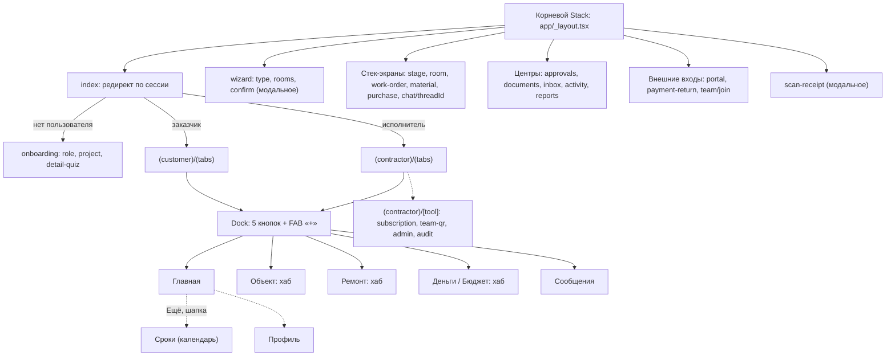

### 1.3. Заказчик: хабы и выходы

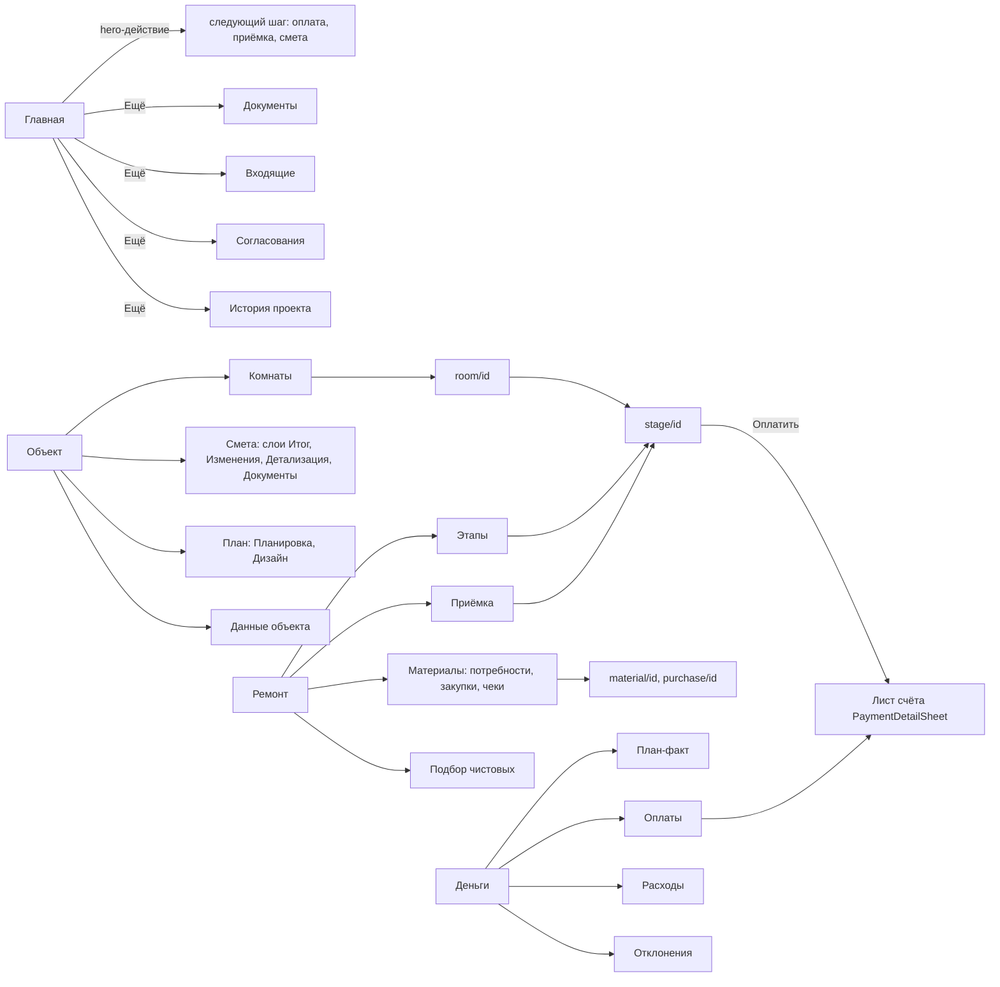

### 1.4. Исполнитель: что добавляется

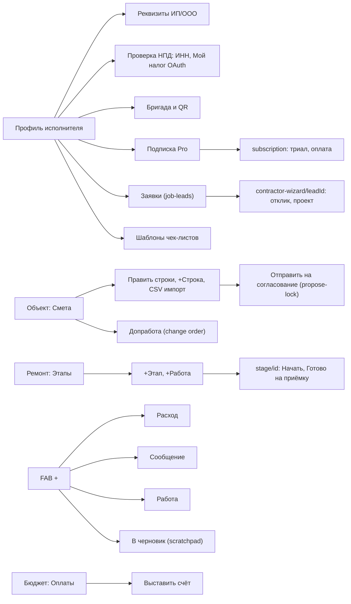

### 1.5. Сквозной поток: смета, этап, приёмка, оплата (экраны)

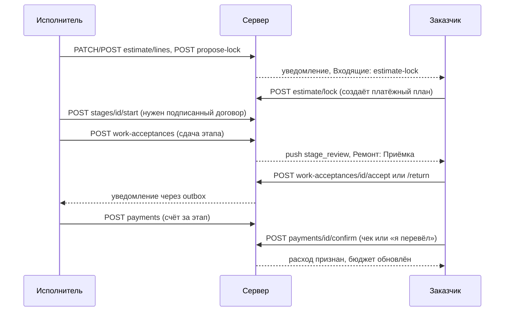

### 1.6. Вход и онбординг

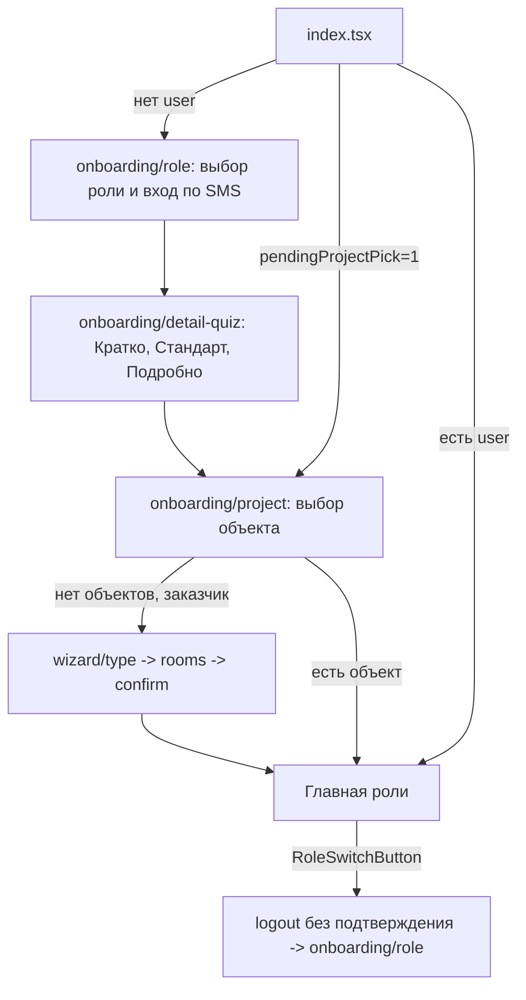

### 1.7. Push и deep-link

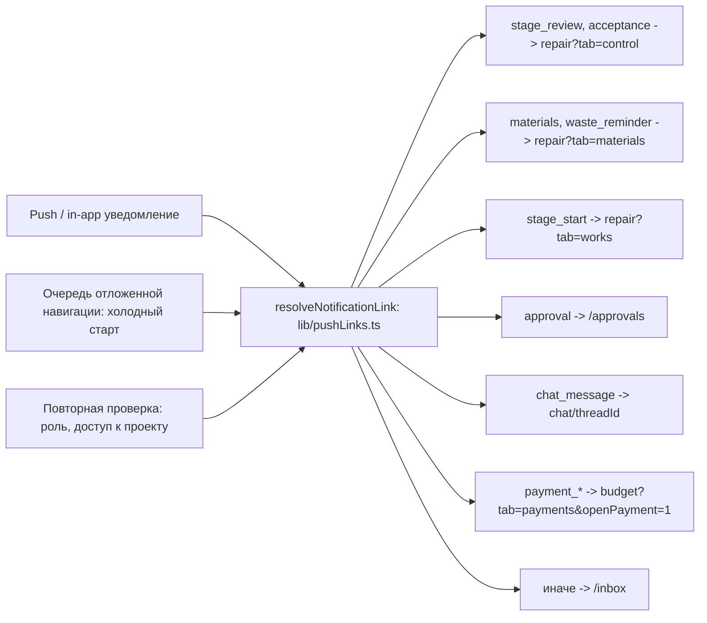

Правило из `AGENTS.md` §8: deep-link заново проверяет авторизацию, роль и доступ и восстанавливает канонический контекст. Тесты: `M/lib/pushLinks.test.ts`, `backendNotificationLinks.contract.test.ts`, `e2e/deep-link-cold-start.spec.ts`.

### 1.8. Легаси-редиректы

| Старый путь | Куда | Источник |
|---|---|---|
| `/work-acceptance`, `/control`, `/quality-control` (заказчик) | `repair?tab=control` | `routeRegistry.ts`, `pushLinks.ts:93-101` |
| `/finance-center` | `budget?tab=payments&openPayment=1` | `routeRegistry.ts` |
| `/work-schedule` | календарь | `routeRegistry.ts` |
| `/notifications` | `/inbox` | `routeRegistry.ts` |
| `/design`, `/project-analytics` | `object?tab=plan&sub=design`, `budget?tab=deviations` | `routeRegistry.ts` |
| `works materials control stages plan rooms estimate finance money` | канонический раздел | `M/constants/osSections.ts` (`ALIAS`), `M/lib/legacyRoutes.ts` (`TAB_ALIASES`, 19 записей) |

## 2. Реестр действий

Колонки: ID, экран, элемент, действие, результат, данные и API, событие аналитики, кто может, источник. Продуктовой аналитики в мобильном приложении нет (поиск по `lib` и `components` находит только тесты и панель `ProjectAnalyticsPanel`; в `PRODUCTION-READINESS.md` телеметрия помечена `NOT_EXTERNALLY_VERIFIED`, #241), поэтому все события колонки «аналитика» это **предложение** в формате `объект.действие`. API-маршруты даны от префикса `/api/v1`; `{p}` = `/projects/{project_id}`.

Условные обозначения ролей: З заказчик, И исполнитель (ведущий), Бр член бригады, Г гость/наблюдатель (readOnly), Т технадзор, А администратор (только web).

### 2.1. Вход, онбординг, мастера

| ID | Экран | Элемент | Действие | Результат | Данные и API | Событие | Кто | Источник |
|---|---|---|---|---|---|---|---|---|
| A-001 | Старт | `index` | Запуск приложения | Редирект: нет user -> `onboarding/role`; `pendingProjectPick` -> выбор объекта; иначе главная роли | `AsyncStorage`, `RenovaContext` | `app.open` | Все | `M/app/index.tsx` |
| A-002 | onboarding/role | Ввод телефона | Запрос кода | SMS-код | `POST /auth/sms/send` | `auth.otp_request` | Все | `M/app/onboarding/_screens/role.tsx`, `B/api/v1/otp_auth.py` |
| A-003 | onboarding/role | Ввод кода | Подтвердить | Сессия, access/refresh токены | `POST /auth/sms/verify` | `auth.login` | Все | то же |
| A-004 | onboarding/role | Выбор роли З или И | Выбрать | Роль сохраняется, дальше квиз | `RenovaContext` | `onboarding.role_select` | Все | `role.tsx` |
| A-005 | onboarding/detail-quiz | Кратко, Стандарт, Подробно | Выбрать | Уровень детализации UI (скрывает виджеты, сужает FAB) | локально `renova_detail_level` | `onboarding.detail_select` | Все | `detail-quiz.tsx`, `M/lib/detailLevelPolicy.ts` |
| A-006 | onboarding/project | Карточка объекта | Открыть | Активный проект, главная | `GET /projects` | `project.open` | Все | `onboarding/_screens/project.tsx` |
| A-007 | wizard/type | Тип объекта и ремонта | Далее | Шаг комнат или быстрый расчёт | локально | `wizard.step` | З | `wizard/_screens/type.tsx` |
| A-008 | wizard/rooms | Комнаты с размерами (режим «Подробно») | Далее | Черновик комнат и сметы | `calc-engine` локально | `wizard.rooms_set` | З | `wizard/_screens/rooms.tsx`, `M/lib/wizard/buildQuickWizardRooms.ts` |
| A-009 | wizard/confirm | «Создать объект» | Отправить | Проект, комнаты, смета по шаблону | `POST /projects` (заменён `project_creation.py`) | `project.create` | З | `wizard/_screens/confirm.tsx`, `B/api/v1/project_creation.py` |
| A-010 | Профиль | «← Выбор роли» (RoleSwitchButton) | Нажать | Выход из аккаунта **без подтверждения**, возврат на выбор роли | `logout()` | `auth.logout` | Все | `M/components/renova/RoleSwitchButton.tsx` [перепись BUD-45] |
| A-011 | Профиль | «Выйти на всех устройствах» | Нажать | Отзыв всех сессий; локальный выход после успеха не выполняется | `POST /auth/sessions/revoke-all` | `auth.revoke_all` | Все | `CustomerProfileScreen.tsx`, `B/api/v1/account_lifecycle.py` [перепись BUD-43] |
| A-012 | Профиль И | «Экспорт данных» | Скачать JSON | Файл выгрузки данных пользователя | `GET /auth/export` | `account.export` | И | `ContractorProfileScreen.tsx` |

### 2.2. Главная, шапка, FAB, поиск

| ID | Экран | Элемент | Действие | Результат | Данные и API | Событие | Кто | Источник |
|---|---|---|---|---|---|---|---|---|
| H-001 | Главная | Hero-действие (следующий шаг) | Нажать | Переход к оплате, приёмке, смете или документу по фазе проекта | `GET /projects/{id}/os/...` сводка | `home.next_action_open` | З, И | `M/components/renova/os/HomeActionHero.tsx` |
| H-002 | Шапка | Переключатель объекта (`OsProjectPicker`) | Выбрать объект | Смена активного проекта, перезагрузка | `GET /projects`, `loadProject` | `project.switch` | Все | `M/components/renova/os/OsProjectPicker.tsx` |
| H-003 | Шапка | Колокольчик | Открыть | `/notification-center`: список, «Отметить все» | `GET /notifications`, `POST /notifications/mark-all-read` | `notification.center_open` | Все | `M/app/notification-center.tsx`, `B/api/v1/notifications.py` |
| H-004 | Шапка | Поиск (`OsSearchModal`) | Ввести запрос | Результаты по проекту; в `OsTabsLayoutOptions` поиск только у И | локально и API | `search.query` | И (по коду) | `OsTabsLayoutOptions.tsx:33` |
| H-005 | Главная | «Ещё» (меню, не более 5) | Открыть пункт | Документы, Входящие, Согласования (только З), История; Отчёты и сводка только в фазе `complete` | `menuRoutes()` | `nav.more_open` | З, И | `M/lib/routeRegistry.ts`, `navigationPolicy.ts` |
| H-006 | Главная | Бейдж «задач сегодня» | Нажать | Календарь | `useTodayTaskCount` | `home.today_open` | З, И | `OsDockBar.tsx` |
| H-007 | Dock | Кнопки Главная, Сообщения, Объект, Ремонт, Бюджет | Нажать | `router.navigate` к вкладке; бейдж непрочитанных у «Сообщения» | `useChatUnread` | `nav.dock_tap` | Все | `OsDockBar.tsx` |
| H-008 | FAB «+» | Круглая кнопка | Нажать | Лист «Создать» | локально | `fab.open` | З, И, не Г | `M/components/renova/os/OsQuickFab.tsx` |
| H-009 | FAB | «Расход» | Выбрать | Лист: «Скан чека» или «Вручную» | локально | `fab.expense` | З, И | `OsQuickFab.tsx` |
| H-010 | FAB | «Скан чека» | Выбрать | `/scan-receipt` с привязкой к текущей комнате или этапу | `nav.scanReceipt` | `receipt.scan_start` | З, И | `OsQuickFab.tsx` |
| H-011 | FAB | «Вручную» | Выбрать | `budget?tab=expenses` с контекстом | `budgetTabHref` | `expense.manual_start` | З, И | `OsQuickFab.tsx` |
| H-012 | FAB | «Сообщение» -> «Создать чат» | Ввести тему, создать | Новый чат проекта и переход в него | `GET /chats` (inbox), создание треда через `createProjectChat` | `chat.create` | З, И | `OsQuickFab.tsx`, `M/lib/createProjectChat.ts` |
| H-013 | FAB | «Все чаты» | Выбрать | Вкладка «Сообщения» | навигация | `chat.list_open` | З, И | `OsQuickFab.tsx` |
| H-014 | FAB (только И) | «Работа» | Выбрать | `CreateWorkSheet`: заказ в календаре | `POST {p}/work-orders` | `work_order.create` | И | `OsQuickFab.tsx`, `CreateWorkSheet.tsx` |
| H-015 | FAB (только И) | «В черновик» | Выбрать | `/scratchpad` | `{p}/scratchpad` | `scratchpad.open` | И | `OsQuickFab.tsx` |
| H-016 | FAB | Автоскрытие при прокрутке вниз | Прокрутка | Кнопка уезжает; на смену экрана возвращается | `lib/fabAutoHide.ts` | не нужна | Все | `OsQuickFab.tsx`, `M/constants/fab.ts` |

Расхождение: канон `renova-design-system.mdc` (стр. 77) и `DESIGN.md` описывают FAB как «Расход · Сообщение · Замечание · Фото, без Черновик». В коде FAB содержит «Расход» и «Сообщение», у исполнителя ещё «Работа» и «В черновик»; «Замечание» и «Фото» из FAB убраны сознательно (`detailLevelPolicy.ts`: «Remark/photo/change через hub Приёмка/Объект»). См. раздел «Расхождения».

### 2.3. Объект: комнаты, смета, план, данные

| ID | Экран | Элемент | Действие | Результат | Данные и API | Событие | Кто | Источник |
|---|---|---|---|---|---|---|---|---|
| O-001 | Объект | Вкладки Комнаты, Смета, План, Данные | Переключить | Смена `?tab=` | локально | `object.tab_change` | Все | `OsObjectHubScreen.tsx` |
| O-002 | Комнаты | «Новая комната» (`CreateRoomSheet`) | Создать | Комната с размерами | `POST {p}/rooms` | `room.create` | З, И | `CreateRoomSheet.tsx`, `B/api/v1/rooms.py` |
| O-003 | Комнаты | Карточка комнаты | Открыть | `/room/[id]` | `GET {p}/rooms/{id}` | `room.open` | Все | `OsRoomsScreen.tsx` |
| O-004 | Комната | Тип комнаты, размеры | Изменить | Пересчёт метрик; изменения у З через запрос | `PATCH rooms`, `room_requests` | `room.update` | З, И | `RoomDetailScreen.tsx`, `B/api/v1/room_requests.py` |
| O-005 | Смета (З) | Слой «Итог» | Просмотр | План, факт, статус сметы | `GET {p}/estimate/materials-stats` | `estimate.view` | З, Г | `EstimateSummaryLayer.tsx` |
| O-006 | Смета (З) | «Согласовать и зафиксировать смету» | Подтвердить | Смета заблокирована, создаётся платёжный план по этапам | `POST {p}/estimate/lock` | `estimate.lock` | З | `EstimateSummaryLayer.tsx`, `B/api/v1/estimate.py:181` |
| O-007 | Смета (З) | «Отклонить — нужна правка» | Подтвердить | Предложение исполнителя отклонено (причина зашита в UI) | `POST {p}/estimate/reject-lock` | `estimate.reject_lock` | З | `CustomerEstimateView.tsx:143` |
| O-008 | Смета (З) | «Отозвать предложение» | Нажать | **Мёртвая ветка**: `canWithdrawProposal` не передаётся | `POST withdraw-lock` | `estimate.withdraw_lock` | никто | `EstimateSummaryLayer.tsx` [перепись] |
| O-009 | Смета (З) | Слой «Изменения»: «Согласовать» | Подтвердить | Допработа approved, строка плана бюджета, договор-черновик | `POST {p}/change-orders/{id}/approve` | `change_order.approve` | З | `EstimateChangesLayer.tsx`, `B/api/v1/change_orders.py:139` |
| O-010 | Смета (З) | Слой «Изменения»: «Отклонить» | Подтвердить | Допработа rejected (без причины) | `POST .../reject` | `change_order.reject` | З | то же |
| O-011 | Смета (З) | Слой «Документы»: PDF, CSV, XLSX | Открыть, скачать, поделиться | Файл сметы | `GET {p}/estimate.pdf`, `.csv`, `.xlsx` | `estimate.export` | Все | `EstimateDocumentsLayer.tsx`, `B/api/v1/export.py:52,171,187` |
| O-012 | Смета (З) | «Импорт CSV в смету» | Вставить, импортировать | Кнопка видна З и Г, сервер разрешает **только И** (403) | `POST {p}/estimate/import-csv` | `estimate.import_csv` | И | `EstimateDocumentsLayer.tsx`, `estimate.py:116` [перепись] |
| O-013 | Смета (И) | Поля «Кол-во», «Цена», «Факт» | Изменить (blur) | PATCH строки; при lock 409 | `PATCH {p}/estimate/lines/{id}` | `estimate.line_update` | И, Бр | `ContractorEstimateView.tsx`, `EstimateLineEditorCard.tsx`, `estimate.py:62` |
| O-014 | Смета (И) | «Заметка» строки | Ввести | Сервер **молча игнорирует** поле (`LinePatch` без `notes`) | `PATCH lines` | не нужна | И | `estimate.py:24-27` [перепись OBJ-37] |
| O-015 | Смета (И) | «+ Строка сметы» (`AddEstimateLineForm`) | Сохранить | Новая строка; стабильный `client_request_id`, повтор не дублирует; оффлайн -> очередь | `POST {p}/estimate/lines` | `estimate.line_add` | И | `AddEstimateLineForm.tsx`, `M/lib/api/estimate.ts` |
| O-016 | Смета (И) | «Отправить смету на согласование» | Нажать | `estimate_lock_proposed_at`, снимок строк для diff | `POST {p}/estimate/propose-lock` | `estimate.propose_lock` | И (ведущий) | `ContractorEstimateView.tsx:118`, `estimate.py:151` |
| O-017 | Смета (И) | «Отозвать предложение» | Подтвердить | Предложение снято; только ведущий (403 `contractor_withdraw_required`) | `POST withdraw-lock` | `estimate.withdraw_lock` | И (ведущий) | `ContractorEstimateView.tsx:135` |
| O-018 | Смета (И) | Форма «Изменение сметы (допработа)» | Отправить | Change order `pending`; идемпотентный `client_request_id` | `POST {p}/change-orders` | `change_order.create` | И | `ContractorEstimateView.tsx`, `change_orders.py:49` |
| O-019 | План | Метка комнаты, перетаскивание | Двигать | Позиция метки сохраняется | `PATCH {p}/floor-plans/{plan_id}/pins/{pin_id}` | `floorplan.pin_move` | И, не принят | `FloorPlanPanel.tsx` |
| O-020 | План | «Замечания на плане», тап по плану | Снять фото | Замечание с фото, привязанное к точке плана | загрузка медиа, `POST issue` | `issue.create_on_plan` | З, И (Г: 403 уже после снимка) | `FloorPlanPanel.tsx` [перепись] |
| O-021 | План | «Загрузить план» | Выбрать файл | План этажа | `POST {p}/floor-plans` | `floorplan.upload` | И | `FloorPlanPanel.tsx`, `B/api/v1/floor_plans.py` |
| O-022 | План/Дизайн | «Согласовать» пакет | Подтвердить | `approved` | `POST {p}/design-packages/{pkg_id}/approve` | `design.approve` | З | `DesignPackageList.tsx`, `design_packages.py` |
| O-023 | План/Дизайн | «Отклонить» | отсутствует в мобильном UI | API `.../reject` есть | `design_packages.py:158` | не нужна | нет | `DesignPackageList.tsx:127` [перепись] |
| O-024 | Данные | «Сохранить профиль» | Сохранить | Название, адрес, тип, НДС 0/5/10/20, даты, бюджет заказчика | `PATCH {p}` | `project.profile_save` | З (UI); сервер роль не проверяет | `OsProjectProfileScreen.tsx`, `projects.py:288` [перепись OBJ-03] |
| O-025 | Данные | Технический надзор: «Назначить», «Отозвать» | Подтвердить | Назначение технадзора по коду профиля | `{p}/technical-supervision` | `supervision.assign` | З | `TechnicalSupervisionCard.tsx`, `B/api/v1/technical_supervision.py` |

### 2.4. Ремонт: этапы, приёмка, работы, материалы

| ID | Экран | Элемент | Действие | Результат | Данные и API | Событие | Кто | Источник |
|---|---|---|---|---|---|---|---|---|
| R-001 | Ремонт | Вкладки Этапы, Приёмка, Материалы, Подбор | Переключить | `?tab=`; бейджи ожидающих | `GET {p}/work-acceptances/pending-count`, `GET {p}/selections/pending-count` | `repair.tab_change` | Все | `OsRepairHubScreen.tsx` |
| R-002 | Этапы | Фильтры, поиск | Фильтровать | Локально | — | `works.filter` | Все | `OsWorksScreen.tsx` |
| R-003 | Этапы | «+ Этап» | Создать | Новый этап | `POST {p}/stages` | `stage.create` | И (`can_schedule`) | `CreateStageSheet.tsx`, `B/api/v1/stage_mutations.py:94` |
| R-004 | Этапы | «+ Работа» | Создать | Work order | `POST {p}/work-orders` | `work_order.create` | И | `OsWorksScreen.tsx`, `work_orders.py` |
| R-005 | Этапы | «На приёмку (N)» (массовая сдача, долгое нажатие) | Нажать | Цикл `submitStage` без try/catch | `POST {p}/work-acceptances` ×N | `stage.submit_bulk` | И | `OsWorksScreen.tsx` [перепись] |
| R-006 | Этапы | Карточка этапа | Открыть | `/stage/[id]` | `GET {p}/stages/{id}` | `stage.open` | Все | `OsWorksScreen.tsx:279` |
| R-007 | Этапы | `ReworkSlaWidget` «Продлить» | Нажать | Продление срока доработки; роль на сервере не проверяется | `POST {p}/rework-sla/extend` | `rework.extend` | И | `B/api/v1/rework_sla.py:64` [перепись REP-31] |
| R-008 | Этап | «Начать этап» | Нажать | `planned -> active`; без подписанного договора 403 `contract_not_signed` | `POST {p}/stages/{id}/start` | `stage.start` | И | `StageDetailHero.tsx`, `stage_mutations.py:119` |
| R-009 | Этап | «Готово — на приёмку» | Нажать | Создана приёмка `requested`, этап `review` | `POST {p}/work-acceptances` | `stage.submit` | И | `StageDetailHero.tsx`, `work_acceptances.py:164` |
| R-010 | Этап | Фото «До работ» / «После работ» | Снять, загрузить | Фото этапа | `getUploadUrl`, `PUT` в хранилище, `POST {p}/stages/{id}/photos` | `stage.photo_add` | З, И (по коду любая роль с записью) | `StageDetailScreen.tsx:270`, `stages_ext.py:204` |
| R-011 | Этап | Комментарий, реакции | Отправить | Комментарий этапа | `POST {p}/stages/{id}/comments` | `stage.comment` | З, И, Бр | `StageDetailScreen.tsx`, `stages_ext.py:170` |
| R-012 | Этап (З, review) | Пункт чек-листа | Отметить | Серверный чек-лист; «Свой пункт» только локально | `POST stages/{id}/checklist/toggle` | `stage.checklist_toggle` | З (роль на сервере не проверяется) | `StageDetailAcceptanceFold.tsx`, `B/api/v1/os.py:79` |
| R-013 | Этап (З, review) | «Принять этап» | Подтвердить | Приёмка `accepted`, этап `done`, платёж этапа становится доступен | `POST {p}/work-acceptances/{id}/accept` | `acceptance.accept` | З | `StageDetailAcceptanceFold.tsx`, `work_acceptances.py:191` |
| R-014 | Этап (З, review) | «Вернуть на доработку» | Подтвердить | Приёмка `returned`, замечания, `needs_rework` | `POST .../return` | `acceptance.return` | З | то же, `work_acceptances.py:227` |
| R-015 | Этап (З, review) | «Акт приёмки (PDF)» | Открыть | PDF акта, пока этап в review | `GET {p}/stages/{id}/acceptance.pdf` | `acceptance.pdf_open` | З | `export.py:64` |
| R-016 | Приёмка (З) | «Принять» / «Вернуть» в списке | Подтвердить | Фиксированные комментарии «Работы приняты» / «Нужна доработка» (причину ввести нельзя) | accept / return | `acceptance.accept_inline` | З (кнопки не проверяют readOnly) | `UnifiedAcceptanceList.tsx:138-162` [перепись] |
| R-017 | Приёмка (З) | «Закрыть» / «Подтвердить исправление» замечание | Подтвердить | Замечание `closed`; использует `@deprecated` `closeIssue` | `POST {p}/issues/{id}/close` | `issue.close` | З | `CustomerControlView.tsx`, `lib/api/issues.ts:53` |
| R-018 | Приёмка (И) | «Исправлено» | Подтвердить | Замечание `fixed` | `POST .../close` (роль contractor) | `issue.fix` | И | `ContractorControlView.tsx:94` |
| R-019 | Приёмка (Т) | «Зафиксировать замечание» | Отправить | Замечание технадзора (по capability) | `POST {p}/technical-supervision/issues` | `supervision.issue_create` | Т | `TechnicalSupervisionControlView.tsx`, `technical_supervision_actions.py:31` |
| R-020 | Приёмка (Т) | «Вернуть на доработку» | Подтвердить | Возврат этапа с обязательной причиной | `POST {p}/stages/{id}/reject` | `supervision.return_rework` | Т (`quality_review`) | `stage_review_transitions.py:74` |
| R-021 | Работа | «Следующий шаг»: Опубликовать, Согласовать, Начать, На приёмку, Принять, Вернуть, Отменить | Нажать | Переход статуса work order по матрице ролей | `POST {p}/work-orders/{id}/transition` (`work_orders.py:139`) | `work_order.transition` | З или И по матрице | `WorkOrderDetailScreen.tsx`, `_work_order_service_core.py:43` |
| R-022 | Работа | «Сохранить описание» | Нажать | `PATCH` с `expected_updated_at`, конфликт 409 | `PATCH /work-orders/{id}` | `work_order.edit` | З, И | `WorkOrderDetailPanel.tsx`, `work_orders.py:109` |
| R-023 | Материалы | Потребности, фильтры Купить, Согласовано, Доступно, Не хватает | Фильтровать | Локально | `GET {p}/materials` | `materials.filter` | Все | `OsMaterialsScreen.tsx`, `CALCULATION-REGISTRY.md` §16 |
| R-024 | Материалы | «Создать закупку» из потребности | Нажать | Purchase `draft` | `POST {p}/purchases`, `POST {p}/material-needs/from-estimate` | `purchase.create` | И | `PurchaseList.tsx`, `B/api/v1/purchases.py:80,342` |
| R-025 | Закупка | Смена статуса draft->approved->ordered->paid/partial->delivered | Нажать | Статус; при paid/delivered создаётся расход (`expense_from_purchase`) | `POST {p}/purchases/{id}/status` | `purchase.status_change` | И, З (в аудите: любая сторона, REP-09) | `purchase/[id].tsx`, `purchases.py:255` [перепись P0] |
| R-026 | Подбор | «Согласовать» / «Отклонить» позицию | Подтвердить | `SelectionItem approved/rejected` | `POST {p}/selections/{id}/approve`, `/reject` | `selection.decide` | З | `OsSelectionsScreen.tsx`, `B/api/v1/selections.py` |

### 2.5. Деньги: бюджет, оплаты, расходы, чеки

| ID | Экран | Элемент | Действие | Результат | Данные и API | Событие | Кто | Источник |
|---|---|---|---|---|---|---|---|---|
| B-001 | Деньги | Вкладки План-факт, Оплаты, Расходы, Отклонения | Переключить | `?tab=`, запоминается в `AsyncStorage` | `budgetSummaryHub` | `budget.tab_change` | Все | `OsBudgetHubScreen.tsx` |
| B-002 | План-факт | Главная кнопка «Оплатить X ₽» | Нажать | Открывает лист счёта | локально | `payment.open` | З | `BudgetSummarySection.tsx:105` |
| B-003 | План-факт | «Таблица» (CSV расходов) | Нажать | Экспорт расходов; ошибка не перехватывается | `GET /analytics/expenses.csv` | `expense.export_csv` | Все | `BudgetSummarySection.tsx:271` [перепись BUD-08] |
| B-004 | План-факт | «Рыночная оценка» | Нажать | `/budget-planner`: расчёт по ставкам и региону, «Применить к плану» | `POST /market/estimate`, `PATCH {p}` | `budget.market_estimate` | И | `BudgetSummarySection.tsx:273`, `budget_planner.py:31` |
| B-005 | Оплаты | «Выставить счёт» (`CreatePaymentForm`) | Создать | Платёж `pending` типа stage или material; чипы 30/50/70/100 % | `POST {p}/payments` | `payment.create` | И | `BudgetPaymentsSection.tsx:86`, `payments.py:156` |
| B-006 | Оплаты | Строка счёта | Открыть | `PaymentDetailSheet` | локально | `payment.open` | Все | `BudgetPaymentsSection.tsx:174` |
| B-007 | Лист счёта | «Оплатить картой (ЮKassa)» | Нажать | Checkout, внешний браузер, возврат по `renova://payment-return` | `POST {p}/payments/{id}/yookassa-checkout` | `payment.checkout_start` | З | `PaymentDetailSheet.tsx:318`, `payment_checkout_integrity.py` |
| B-008 | Лист счёта | «Перевести (СБП / реквизиты)» -> «Я перевёл — дальше» | Нажать | Шаг transfer, затем `transfer_ack` | локально | `payment.transfer_ack` | З | `PaymentDetailSheet.tsx:571-578` |
| B-009 | Лист счёта | «Прикрепить чек» | Нажать | `/scan-receipt?paymentId` | навигация | `payment.attach_receipt` | З | `PaymentDetailSheet.tsx:217` |
| B-010 | Лист счёта | «Я оплатил — подтвердить» | Нажать | Платёж `confirmed` (чек) или `paid_unverified` (только «я перевёл»); этап должен быть принят | `POST {p}/payments/{id}/confirm` | `payment.confirm` | З | `PaymentDetailSheet.tsx:385`, `payments.py:301` |
| B-011 | Лист счёта | «Оспорить оплату» | Ввести причину (от 10 симв.) | Платёж `disputed` | `POST {p}/payments/{id}/dispute` (`payment_disputes.py:77`) | `payment.dispute_open` | З | `PaymentDetailSheet.tsx:595` |
| B-012 | Лист счёта | «Отозвать спор» | Ввести, подтвердить | Платёж обратно | `POST {p}/payments/{id}/dispute/resolve` | `payment.dispute_resolve` | З | `PaymentDetailSheet.tsx:607` |
| B-013 | Оплаты | «Подтверждение перевода» (`PaymentEvidenceSheet`) | Выбрать файл, отправить | Вложенное доказательство -> проверка | `payment_evidence.py:90-176` | `payment.evidence_submit` | З | `PaymentEvidenceSheet.tsx` |
| B-014 | Оплаты | «Импорт выписки» | Загрузить, подтвердить | Сопоставление банковской выписки с платежами; подтверждение только З | `POST {p}/import/bank-statement`, `.../confirm` | `bank.import` | З, И (импорт); З (confirm) | `BankStatementImportSheet.tsx`, `bank_statements.py` |
| B-015 | Расходы | «+ Расход без чека» (`ManualExpenseForm`) | Сохранить | Receipt/Expense без ФНС-проверки | `POST {p}/receipts/manual` | `expense.manual_add` | З, И | `ManualExpenseForm.tsx:127`, `receipts.py:326` |
| B-016 | Расходы | Строка расхода | Открыть | `ExpenseDetailSheet` | `PATCH/DELETE` расхода | `expense.open` | Все | `BudgetExpensesSection.tsx:151` |
| B-017 | Расходы | `ExpenseDetailSheet`: «Сохранить», «Удалить трату» | Нажать | Правка/удаление | `PATCH /receipts/{id}`, `DELETE`; `os/expenses/{id}` | `expense.update`, `expense.delete` | З, И (write) | `ExpenseDetailSheet.tsx:209,220` |
| B-018 | Расходы | «Привязать все (N)» / «Применить категорию» | Нажать | Массовый PATCH чеков; роль не проверяется | `PATCH /receipts/{id}` ×N | `receipt.bulk_link` | З, И | `ReceiptBulkLinkPanel.tsx` [перепись] |
| B-019 | scan-receipt | QR-сканер (native) / поле (web) | Скан | Разбор чека, проверка ФНС | `POST {p}/receipts/scan` | `receipt.scan` | Все с проектом (проверки `useWriteAllowed` нет) | `M/app/scan-receipt.tsx:162`, `receipts.py:224` |
| B-020 | scan-receipt | «Разрешить камеру» | Нажать | Запрос разрешения; ветки «отказано навсегда» нет | `expo-camera` | `receipt.camera_permission` | Все | `scan-receipt.tsx:137` |
| B-021 | Отклонения | Строка перерасхода | Открыть | `/room/[id]?overrun=1` | `BudgetAlerts` | `budget.overrun_open` | Все | `BudgetAlerts.tsx:32` |
| B-022 | payment-return | Экран возврата | Открыть | Подтверждение и переход к оплатам | deep link | `payment.return` | З | `M/app/payment-return.tsx` |

### 2.6. Сообщения, входящие, согласования, документы, портал, подписка

| ID | Экран | Элемент | Действие | Результат | Данные и API | Событие | Кто | Источник |
|---|---|---|---|---|---|---|---|---|
| C-001 | Сообщения | Табы «Чаты / Архив», фильтр объектов | Выбрать | Локально, `chatPrefs` | — | `chat.filter` | Все | `ChatListView.tsx` |
| C-002 | Сообщения | «Создать чат» (`CreateChatSheet`) | Создать | Чат, приглашения по телефону или коду; без проверки readOnly | `createProjectChat` (создание треда проекта) | `chat.create` | З, И | `ChatListView.tsx:259`, `chats.py:159` |
| C-003 | Сообщения | Карточка чата (долгое нажатие) | Закрепить, В архив | `PATCH {p}/chats/{id}/state` | `chats.py:210` | `chat.state_change` | Все | `ChatListView.tsx:179` |
| C-004 | Чат | Поле + «Отправить» | Отправить | Сообщение; доставка по WebSocket, при отказе опрос 15 с | `POST {p}/chats/{id}/messages`; WS `/ws` | `chat.message_send` | не Г | `ChatThreadView.tsx:582`, `B/api/v1/ws.py` |
| C-005 | Чат | Фото, Файл | Выбрать | Вложение как data-URL; только image/* (видео 422); сжатия нет | `image_data` | `chat.attachment_send` | не Г | `ChatThreadView.tsx:594,604` [перепись] |
| C-006 | Чат | «Счёт» | Выбрать сумму | Платёж `pending` из чата | `POST {p}/chats/{id}/invoice` (`invoiceFromChat`) | `payment.create_from_chat` | И | `ChatThreadView.tsx:627` |
| C-007 | Чат | «✓?» запросить согласование | Нажать | Сообщение типа `confirm` | message | `chat.confirm_request` | И | `ChatThreadView.tsx:618` |
| C-008 | Чат | «Подтвердить» сообщение confirm | Нажать | Подтверждение; по коду доступно и автору-исполнителю | `POST {p}/chats/{id}/messages/{mid}/confirm` | `chat.confirm` | З (ожидаемо) | `ChatThreadView.tsx:539` [перепись] |
| C-009 | Чат | «Создать задачу из сообщения» | Выбрать срок, исполнителя | Work order | `POST {p}/chats/{id}/messages/{mid}/task` | `work_order.create_from_chat` | З, И | `ChatTaskSheet.tsx` |
| C-010 | Чат | «Документ» | Нажать | PDF чата | `GET {p}/chats/{id}.pdf` | `chat.export` | Все | `ChatThreadView.tsx:476` |
| C-011 | Чат | «+ Участник» | Пригласить по коду или телефону | Приглашение; SMS через outbox `chat.invitation_sms` | `POST {p}/chats/{id}/invite` | `chat.invite` | управляющие чатом | `ChatThreadView.tsx:700`, `outbox_service.py:26` |
| C-012 | Входящие | Строки задач (оплата, приёмка, согласование, смета, договор, замечания, материалы) | Нажать | Переход в канонический хаб | `buildInboxItems` из нескольких API | `inbox.item_open` | З, И | `UnifiedInboxScreen.tsx`, `M/lib/domain/buildInboxItems.ts` |
| C-013 | Входящие | Строка `offline-queue` | Нажать | `flushOfflineOutbox()`, сообщений пользователю нет | локальная очередь | `offline.flush_manual` | Все | `offlineInbox.ts` |
| C-014 | Согласования | «Согласовать» / «Отклонить» | Подтвердить | Решение по материалу, допработе, дизайну, вывозу; причина отклонения необязательна | `POST {p}/approvals/{id}/approve`, `/reject` | `approval.decide` | З | `M/app/approvals.tsx:51`, `approvals.py:246` |
| C-015 | История | Фильтры, строка события | Открыть | Переход по `link_path` | `GET {p}/activity` | `activity.item_open` | Все | `ActivityFeed.tsx`, `B/api/v1/activity.py` |
| D-001 | Документы | «+ Файл» | Выбрать файл | Загрузка документа (кнопка видна и Г) | `POST {p}/documents/upload` | `document.upload` | З, И | `DocumentsHub.tsx:879`, `documents.py:417` |
| D-002 | Документы | «Подписать в приложении» | Нажать | Подпись in_app, без дополнительного confirm | `POST {p}/documents/{id}/sign` | `document.sign_in_app` | З, И | `DocumentsHub.tsx:678`, `B/services/esign/in_app.py` |
| D-003 | Документы | «Подписать через Контур» | Нажать | Внешняя подпись, опрос статуса; сервер 501, если провайдер выключен | `POST .../sign (kontur)`, `GET /esign/providers` | `document.sign_external` | З, И | `DocumentsHub.tsx:688` |
| D-004 | Документы | «Распознать тип (OCR)» | Нажать | Классификация по метаданным | `POST .../ocr` | `document.ocr` | З, И | `DocumentsHub.tsx:723`, `document_ocr_runtime.py` |
| D-005 | Документы | «Legal hold», «Архив» | Нажать | Блокировка удаления; архив без подтверждения | `.../legal-hold`, `.../archive` | `document.archive` | З, И | `DocumentsHub.tsx:732,739` |
| D-006 | Документы | Экспорты: 1С CSV/XML/CommerceML, реестр для банка, ICS, XLSX | Скачать | Файлы выгрузок | `GET {p}/export/1c-payments.csv` и др. | `export.download` | Все | `export.py:301-361` |
| D-007 | Документы | «Недельный дайджест» | Нажать | Дайджест в Входящие, один тап без подтверждения | `POST {p}/digest/weekly` | `digest.send` | З, И | `DocumentsHub.tsx:251`, `export.py:397` |
| D-008 | Документы | «Гарантийное обращение» | Создать | Claim, атомарно с уведомлением | `POST {p}/warranty-claims` | `warranty.create` | З, И | `DocumentsHub.tsx:289`, `warranty.py` |
| D-009 | Документы | «Завершение объекта» | Завершить | `closeout`; после него смета, график, счета и этапы заперты (409 `project_closed`) | `GET/POST {p}/closeout` | `project.closeout` | З (завершает), И | `export.py:672-683`, `B/api/project_lock.py` |
| D-010 | Профиль З/И | «Портал заказчику» / PortalSharePanel | Поделиться ссылкой | Magic-link токен HMAC, срок 168 ч, права по переключателям (приёмка, оплата — включены по умолчанию) | `POST {p}/portal-link` | `portal.link_create` | З, И (в перепись: И выпускает токен с правами З, P0) | `PortalSharePanel.tsx`, `portal.py:125` [перепись BUD-40] |
| D-011 | Портал | «Принять этап» / «На доработку» | Нажать | Решение гостя по токену | `POST /portal/projects/{id}/work-acceptances/{id}/accept|return` | `portal.acceptance_decide` | Гость по scope | `PortalScreen.tsx:693`, `portal_acceptance_decisions.py` |
| D-012 | Портал | «Согласовать»/«Отклонить» допработу, «Зафиксировать смету» | Нажать | Решение гостя | `portal_change_order_decisions.py`, `/estimate/lock` | `portal.change_decide` | Гость по scope | `PortalScreen.tsx:724-770` |
| D-013 | Портал | «Оплатить картой» / «Подписать» | Нажать | Checkout и in_app подпись по токену | `yookassa-checkout`, `.../sign` | `portal.pay`, `portal.sign` | Гость по scope | `PortalScreen.tsx:823,866` |
| D-014 | Профиль З | ViewerSharePanel: «Добавить гостя» | Ввести телефон | Гость-наблюдатель | `POST {p}/viewers` | `viewer.add` | З | `ViewerSharePanel.tsx:70` |
| D-015 | Профиль И | TeamSection: «Создать бригаду», «Пригласить», «QR-код бригады» | Нажать | Бригада, инвайт, `/team-qr` | `POST /teams`, `/teams/.../invite` | `team.create`, `team.invite` | И | `ContractorProfileScreen.tsx`, `B/api/v1/teams.py` |
| D-016 | team/join | Токен-ссылка | Открыть | Вступление в бригаду | `team_invite_join_service.py` | `team.join` | И | `M/app/team/join/[token].tsx` |
| S-001 | subscription | «Начать триал 14 дней» | Нажать | Подписка Pro `active` на период триала | `POST /subscription/start-trial` | `subscription.trial_start` | И | `M/app/(contractor)/_screens/subscription.tsx:55`, `subscription.py:46` |
| S-002 | subscription | «Оформить Pro 990 ₽/мес» | Нажать | Checkout ЮKassa; недоступно в режиме `off` | `POST /subscription/checkout` | `subscription.checkout_start` | И | `subscription.tsx:73,149` |
| S-003 | Профиль И | Поле ИНН + «Проверить и сохранить НПД» | Нажать | Статус самозанятого (публичный API ФНС); любая ошибка показывается как «Сервис недоступен» | `POST /fns/verify-me` | `npd.verify` | И | `ContractorProfileScreen.tsx:222`, `fns.py:106` |
| S-004 | Профиль И | «Авторизовать «Мой налог» (OAuth)» | Нажать | Старт OAuth; без реквизитов клиента ФНС выключено | `POST /fns/moy-nalog/oauth/start`, `.../callback` | `moynalog.oauth_start` | И | `ContractorProfileScreen.tsx:239`, `fns.py:179,219` |
| S-005 | Профиль И | «Включить флаг (без OAuth)» | Нажать | Backend всегда отвечает 410 | `POST /fns/moy-nalog/link` | `moynalog.link` | И | `ContractorProfileScreen.tsx:267`, `fns.py:130` [перепись] |
| S-006 | Заявки | Отклик на заявку (`JobLeadsBoard`) | Нажать | Лид -> КП -> мастер `contractor-wizard` -> проект | `B/api/v1/marketplace.py` | `lead.quote` | И | `JobLeadsBoard.tsx:239` |
| X-001 | Любой экран | Офлайн-баннер, `/conflicts` | Открыть | Очередь `renova_offline_queue`: повторы до 5 раз, 409 остаётся для ручного разбора | `lib/offlineQueue.ts` | `offline.conflict_open` | Все | `OfflineSyncBanner.tsx`, `M/app/conflicts.tsx` |
| X-002 | Админ (web) | `outbox-dead-letters`, `provider-reconciliations`, `refund-reviews` | Повтор, закрыть | Операторский разбор DLQ с аудитом | `/admin/outbox/dead-letters`, `/admin/provider-reconciliations`, `/admin/subscription-refunds/reviews` | `admin.dlq_replay` | А (`ADMIN_USER_IDS`) | `M/app/(contractor)/_screens/outbox-dead-letters.tsx`, `B/api/v1/admin_outbox_dead_letters.py` |

Итого строк в реестре: 12 (A) + 16 (H) + 25 (O) + 26 (R) + 22 (B) + 15 (C) + 16 (D) + 6 (S) + 2 (X) = **140**. Реестр поддерживать при любом изменении кнопки, маршрута или API (предложение для `AGENTS-SNIPPET.md`).

## 3. Модель данных

Схема: `B/models/entities.py` (1195 строк, 70+ классов), плюс `B/models/*.py` (outbox, провайдеры, участники, графики работ, документы, технадзор). Alembic: одна голова `x09selectionqty01` (`PRODUCTION-READINESS.md` §1). Значения полей не приводятся.

### 3.1. Основные сущности

| Сущность | Таблица | Ключевые поля | Связи |
|---|---|---|---|
| User | `users` | `role` (`customer`/`contractor`), телефон, статус | 1→N Project (как заказчик и как исполнитель), 1→1 Subscription, N↔N Team |
| Project | `projects` | `customer_id`, `contractor_id`, `budget_planned`, `budget_spent`, `progress_percent`, `planned_start/end`, `estimate_locked_at`, `estimate_lock_proposed_at/by`, `estimate_propose_snapshot_json`, `vat_rate`, `trashed_at`, `is_archived` | 1→N Room, EstimateLine, Stage, Payment, ChangeOrder, Receipt, ChatThread, WorkOrder |
| Room | `rooms` | размеры, тип | 1→N EstimateLine; N↔N Stage (`room_ids_json`) |
| EstimateLine | `estimate_lines` | `line_type` (material/work), `quantity_planned`, `quantity_actual`, `unit_price`, `category`, `calc_detail` | N→1 Project, N→1 Room |
| Stage | `stages` | `status`, `percent_complete`, `payment_amount`, `weight_coefficient`, `planned_*`, `actual_*`, `contractor_ready`, `needs_rework`, `rework_deadline`, `depends_on_stage_id`, `assignee_id` | N→1 Project; 1→N StageComment, StagePhoto, Payment, WorkAcceptance |
| WorkAcceptance | `work_acceptances` | `status`, комментарий, оценка качества | N→1 Stage |
| Payment | `payments` | `payment_type`, `status`, `amount`, `stage_id`, `change_order_id`, `yookassa_payment_id`, `payment_method`, `confirmed_at` | N→1 Project, N→1 Stage, N→1 ChangeOrder; 1→N PaymentEvent, PaymentEvidence |
| ChangeOrder | `change_orders` | `amount`, `status`, `stage_id` | N→1 Project; 1→N Payment |
| Receipt / Expense | `receipts`, `expenses` | верификация ФНС, категория, привязка к комнате, этапу, закупке, платежу | N→1 Project |
| Purchase / PurchaseItem / Supplier | `purchases`... | `status`, `total_amount` | N→1 Project |
| MaterialPick, SelectionItem | `material_picks`, `selection_items` | подбор и чистовые материалы | N→1 Project |
| BudgetLine | `budget_lines` | плановая строка бюджета по статье | N→1 Project |
| ChatThread / ChatMessage | `chat_threads`, `chat_messages` | `type` (text, photo, file, confirm, system, task, invoice, payment) | N→1 Project |
| AppNotification, PushToken | | `notification_type`, `link_path`, `read` | N→1 User |
| ProjectIssue | `project_issues` | `severity`, `status` | N→1 Project, Stage |
| WorkOrder | `work_orders` | `status`, `chat_thread_id`, `stage_id` | N→1 Project |
| Subscription | `subscriptions` | `status` (free/active), `plan`, `expires_at` | 1→1 User |
| SubscriptionCheckout и возвраты | `subscription_checkout.py` | сессия оплаты Pro | N→1 User |
| ProjectParticipant, ProjectViewer, PortalLink | | роли внутри проекта, гости, токены | N→1 Project |
| Team, TeamMember, TeamInvite | | бригада исполнителя | N↔N User |
| JobLead, JobLeadQuote | | заявки маркетплейса | N→1 Project после конверсии |
| ProjectDocument и версии | `project_documents.py` | версии, подписи, legal hold | N→1 Project |
| DomainOutbox, DomainOutboxLease, SideEffectDelivery | | `event_type`, `payload_json`, `attempts`, `locked_by`, `next_attempt_at` | независимая шина |
| ProviderReconciliation | `provider_reconciliations` | `provider`, `operation_type`, `status` (pending/retry/completed/terminal/unavailable), `claim_generation` | ссылается на ресурс по типу и id |
| PaymentWebhookEvent, PaymentEvent | | идемпотентность webhook, журнал статусов | N→1 Payment |
| UserSession | `user_sessions` | ротация refresh-токена | N→1 User |

### 3.2. ER-диаграмма ядра

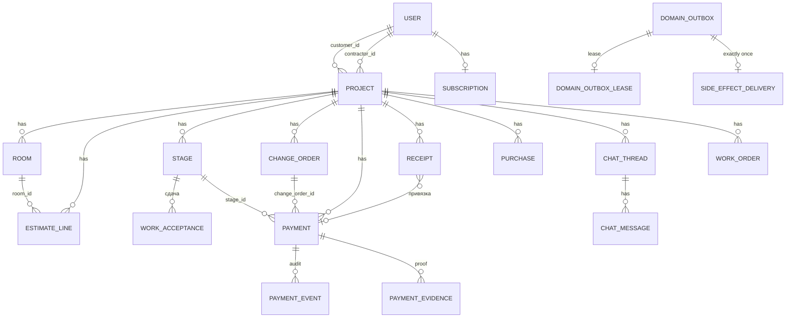

Замечание по типам: денежные колонки в `entities.py` объявлены как `Float` (`Payment.amount`, `Project.budget_planned` и т.д.), а денежная арифметика в `budget_service.py` ведётся через `Decimal` с округлением `ROUND_HALF_UP` до копеек (`CALCULATION-REGISTRY.md` §2 сам называет это «float-compatible хранением» и требует тестов на крайние суммы). Расчёт сметы в `B/services/calc/estimate.py` и в `calc-engine` использует `round(n, 2)` на float (в Python это не `ROUND_HALF_UP`).

## 4. Жизненные циклы

### 4.1. Этап (`StageStatus`: planned, active, review, done)

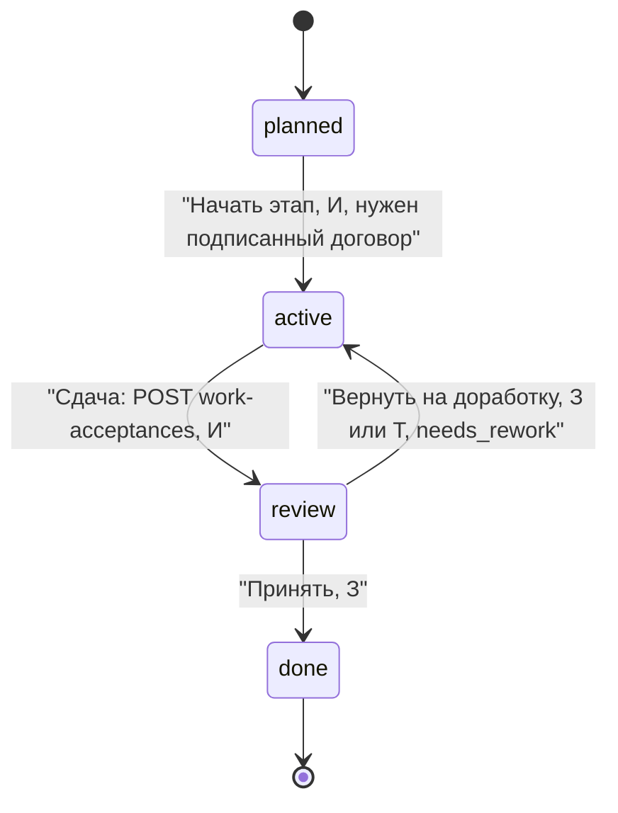

Запрещено: старт этапа без подписанного договора (403 `contract_not_signed`), старт без выполненных зависимостей (409), приёмка при открытых замечаниях (GP4 N1), старт по готовности материалов (`STAGE-START-AUTHORITY-CONTRACT.md`). Источники: `B/models/entities.py:20`, `B/api/v1/stage_mutations.py:119`, `B/api/v1/work_acceptances.py`, `B/services/stage_status_service.py`.

### 4.2. Приёмка (`AcceptanceStatus`)

Состояния: `not_requested`, `requested`, `in_review`, `accepted`, `accepted_with_remarks`, `returned`, `rejected` (`entities.py:1001`). Основной путь `requested -> accepted` (З) или `requested -> returned` (З, с созданием замечаний). Финальное решение принимает только заказчик (`work_acceptance_decision_service._require_customer`), технадзор только возвращает этап и фиксирует замечания.

### 4.3. Платёж (`PaymentStatus`)

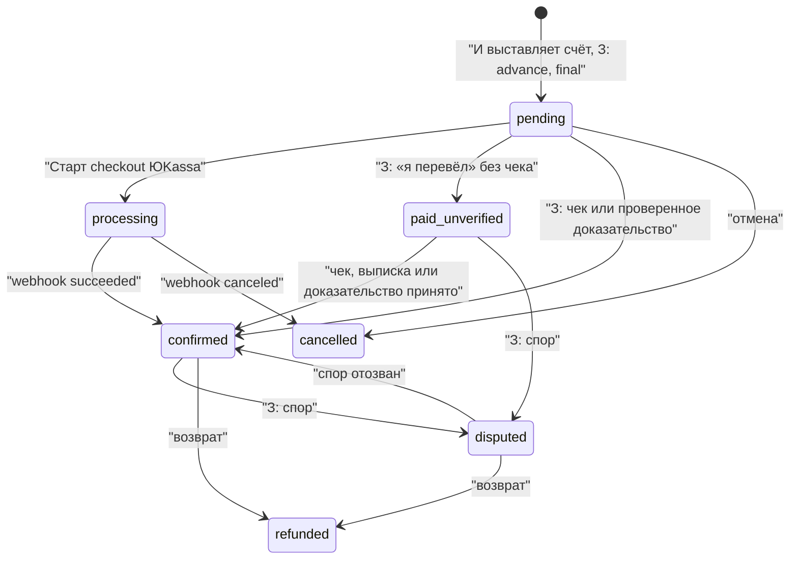

Правила: оплата этапа невозможна, пока этап не принят (`payments.py`, `payment_service.py:259`); `paid_unverified` не попадает в `budget_spent`; расход признаётся только из `confirmed` платежа (`expense_from_payment`); одна операция не увеличивает расход дважды (`AGENTS.md` §6). Переходы между статусами выведены из enum, маршрутов и реестра расчётов; полная таблица допустимых пар в `payment_service.py` читалась выборочно (**неподтверждено полностью**).

### 4.4. Допработа (`ChangeOrderStatus`)

`pending -> approved` или `pending -> rejected`; решает только заказчик; финальные состояния дают 409. Создаёт только исполнитель, `amount > 0`. При `approved` увеличивается `budget_planned` (`sync_project_budget_planned`) и создаётся черновик договора (`change_orders.py:139`, `CALCULATION-REGISTRY.md` §4).

### 4.5. Смета (состояние выводится из двух дат, отдельного enum нет)

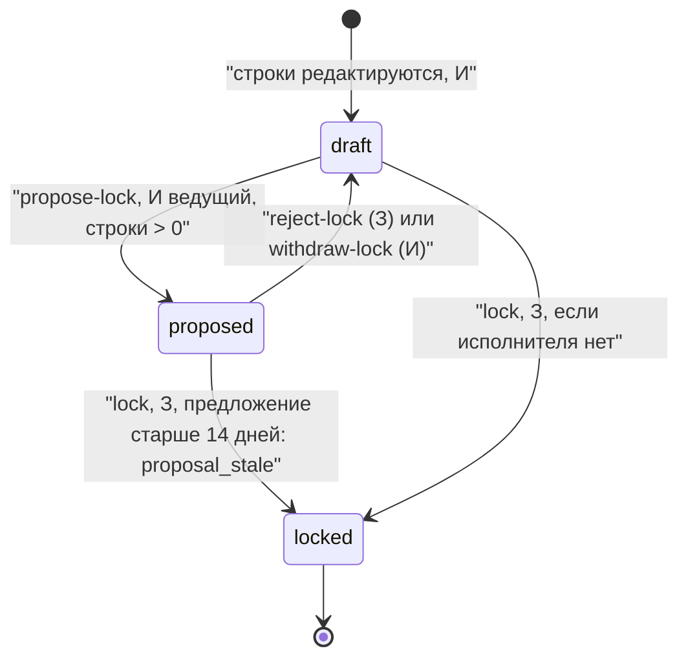

Источник: `B/services/estimate_service.py:256-317`, `B/api/v1/estimate.py`. При `locked` правка строк даёт 409 `estimate_locked`; после `closeout` проекта блокируется всё (`project_lock.py`).

### 4.6. Закупка (`PurchaseStatus`)

`draft -> approved -> ordered -> paid | partial -> delivered`, плюс `cancelled` и `returned` (после delivered). Расход создаётся при `paid` и `delivered` с положительной суммой (`CALCULATION-REGISTRY.md` §5). Кто может менять статус, в аудите назван P0 (REP-09): любая сторона проекта.

### 4.7. Работа (`WorkOrderStatus`)

Матрица `ROLE_ALLOWED` (`_work_order_service_core.py:43`): `draft -> published` (обе роли), `published/negotiating -> approved` (только З), `approved -> in_progress` и `in_progress -> review` (только И, при самоуправляемом проекте допускается З), `review -> done` (только З), `review -> in_progress` (обе), `cancelled` из большинства состояний.

### 4.8. Замечание (`ISSUE_TRANSITIONS`)

`open -> in_progress | fixed`, `assigned -> in_progress | fixed`, `in_progress -> fixed`, `fixed -> closed | open`, `review -> closed | open`, `closed -> open`, `rejected` терминальное. Исполнитель ведёт `open -> fixed`, заказчик закрывает `fixed -> closed`, технадзор может закрыть и переоткрыть, но не исполнять. В проекте без исполнителя заказчик закрывает сразу (`SELF_MANAGED_CUSTOMER_EXTRA`). Источник: `B/services/issue_service.py:18-66`.

### 4.9. Подписка исполнителя

`free -> active` (триал 14 дней или оплата Pro 990 ₽/30 дней), возврат через `admin_subscription_refunds` с ручной проверкой; сверка статуса оплаты через `ProviderReconciliation` (`yookassa/payment_status`). Источник: `B/services/subscription_service.py`, `subscription_checkout_service.py`, `subscription_refund_service.py`.

### 4.10. Событие outbox

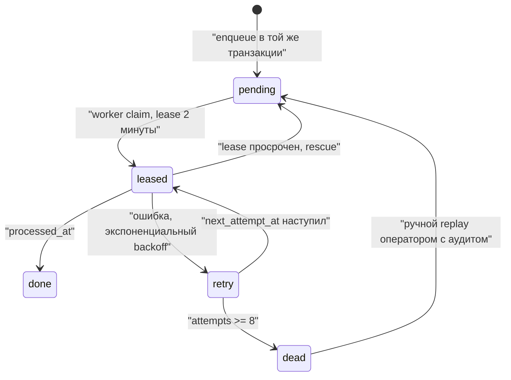

Константы: `MAX_ATTEMPTS = 8`, `LEASE_TTL = 2 минуты`, `delay = min(RETRY_MAX, RETRY_BASE × 2^(n-1))` (`B/services/outbox_service.py:27-28,130`).

## 5. Роли и права

### 5.1. Как устроены права

- На уровне аккаунта две роли: `customer`, `contractor` (`UserRole`). Администратор не отдельная роль: это исполнитель, чей `user.id` входит в `ADMIN_USER_IDS` (в staging и production обязательно; в локальной среде любой исполнитель) (`B/api/admin_access.py`).
- На уровне проекта точная роль определяется `project_actor_role`: `customer` (владелец), `lead` (ведущий исполнитель), `foreman`, `member`, `viewer` (бригада), `guest`, `none` (`B/services/project_role_policy.py`). Режимы доступа: `owner`, `contractor`, `guest`, `participant`, `none` (`B/services/team_service.py:527`).
- Любой проектный маршрут начинается с `require_project(write=...)` (`B/api/deps.py:168`): 404 для несуществующего, 403 при отсутствии доступа; технадзор получает только чтение. Независимый исполнитель-участник действует строго в своём scope этапов (`participant_scope_forbidden`).
- Деньги и параметры решает заказчик (`require_project_owner`, код `customer_only`); реквизиты исполнителя видят только владелец и ведущий (JRN-031).
- На клиенте проверки роли при маршрутизации нет: роль экрана берётся из группы маршрута, а не из `user.role` [перепись §2]. Защита серверная.

### 5.2. Матрица роль × действие

Обозначения: + можно, ○ только чтение, − нельзя, ! есть расхождение между интерфейсом и сервером.

| Действие | З | И ведущий | Бр (member/foreman) | Г | Т | А | Основание |
|---|---|---|---|---|---|---|---|
| Создать проект / мастер | + | − (UI скрыт, ссылка зашита `'customer'`) | − | ! | − | − | `project_creation.py`, `ProjectEmptyState.tsx:387` |
| Править профиль проекта (`PATCH /projects/{id}`) | + | ! (сервер роль не проверяет) | ! | − | − | − | `projects.py:288`, [перепись OBJ-03] |
| Править строки сметы | − | + | + (кроме viewer) | − | − | − | `estimate.py:62`, `_require_estimate_editable` |
| Предложить фиксацию сметы | − | + (только ведущий) | − | − | − | − | `estimate.py:151` |
| Зафиксировать / отклонить смету | + | − | − | − | − | − | `estimate.py:181,215` |
| Импорт CSV сметы | − (кнопка видна) | + | ! | − | − | − | `estimate.py:116` |
| Создать допработу | − | + | ! | − | − | − | `change_orders.py:49` |
| Утвердить / отклонить допработу | + | − | − | − | − | − | `change_orders.py:139,183` |
| Создать этап / стартовать | − | + (`can_schedule`) | + | − | − | − | `stage_mutations.py` |
| Сдать этап на приёмку | − | + | + | − | − | − | `work_acceptances.py:164` |
| Принять / вернуть этап | + | − | − | − | ○ (возвращать через `quality_review`) | − | `work_acceptance_decision_service`, `stage_review_transitions.py:74` |
| Выставить счёт | ○ (advance, final по коду) | + (stage, material) | ! | − | − | − | `payments.py:147-180` |
| Подтвердить платёж, спор, доказательство | + | − | − | − | − | − | `payments.py:285`, `payment_disputes.py`, `payment_evidence.py:86` |
| Импорт выписки: загрузка / подтверждение | + / + | + / − | ! | − | − | − | `bank_statements.py:48,87` |
| Скан чека, ручной расход | + | + | + | ! (проверки write на экране нет) | − | − | `receipts.py:224,326` |
| Согласования (материалы, дизайн, вывоз) | + | − (скрыто) | − | ○ | − | − | `approvals.py`, `navigationPolicy.ts:80` |
| Чат: писать, приглашать | + | + | + | − | − | − | `chats.py` (`write=True`) |
| Подписать документ in_app | + | + | + | − | − | − | `documents.py:296` (любой с write) |
| Портал-ссылка | + | ! (выпускает токен с правами заказчика) | − | − | − | − | `portal.py:125`, [перепись BUD-40, P0] |
| Подписка Pro, НПД, «Мой налог» | − | + | + | − | − | − | `subscription.py`, `fns.py` |
| Админ-экраны (DLQ, сверки, возвраты, аудит) | − | ! (кнопки видны на web всем исполнителям) | ! | − | − | + | `admin_access.py`, `AdminHubLink.tsx:12` |

Источник строк с «!»: перепись `docs/audit-map/09-screen-census-routes.md` §2 и разборы по экранам; сверка с кодом `B/api` выполнена для оценок `estimate.py`, `change_orders.py`, `admin_access.py`, `project_role_policy.py`, остальные строки опираются на перепись от 2026-09-30 и требуют проверки на актуальном `main`.

## 6. События и уведомления

### 6.1. События домена (outbox)

| Событие | Что запускает | Обработчик | Источник |
|---|---|---|---|
| `financial.payment_created` | создание платежа (уведомление «счёт») | `notification_service.notify_from_outbox` | `outbox_service.py:20,694` |
| `financial.receipt_created` | создание чека | `activity_service.log_event_from_outbox` | `outbox_service.py:21,711` |
| `notification.created` | любое пользовательское уведомление | push и запись `AppNotification` | `outbox_service.py:22` |
| `activity.created` | запись в историю проекта | `activity_service` | `outbox_service.py:23` |
| `acceptance.side_effects` | решение по приёмке | раскрывает в activity и notification с `enqueue_once` | `outbox_service.py:24,527` |
| `esign.submission` | внешняя подпись | `esign_submission_service` | `outbox_service.py:25` |
| `chat.invitation_sms` | приглашение в чат по телефону | `chat_invitation_delivery` | `outbox_service.py:26` |

Идентичность строки детерминирована (`uuid5`), повторная постановка не дублирует; обработка с lease и fencing; DLQ с ручным replay и аудитом (`AGENTS.md` §5).

### 6.2. Типы уведомлений

`NotificationType` (`entities.py:326`): stage_review, stage_started, room_updated, room_created, payment_pending, payment_confirmed, change_order, room_change, chat_message, budget_alert, reaction, materials, approval, issue, deadline, waste_reminder, document, other. Устаревшие строки приводятся алиасами (`material`, `budget`, `stage_start`, `schedule_review`, `schedule_confirmed`, `schedule_rejected`) в `notification_service._TYPE_ALIASES`; неизвестное значение превращается в `other`. Ссылка уведомления переписывается под группу роли получателя (`notification_links.link_for_role`). Пуш: Expo, с реконсиляцией квитанций воркером (`push_receipt_worker`).

### 6.3. Фоновые задачи воркера

`domain_outbox`, `provider_reconciliation` (ЮKassa `payment_status`, ФНС `receipt_verify`), опционально `automation_reminders` и `push_receipt_reconciliation` (`B/worker_main.py:_task_names`).

### 6.4. Предлагаемые события аналитики

Единый формат `объект.действие`, перечень приведён в колонке «Событие» раздела 2. Принципы: без ПДн в свойствах; идентификаторы хэшировать; суммы не отправлять, отправлять диапазон; источник правды по деньгам остаётся серверным. Для метрик плана (`01-business-plan.md` §12) минимально нужны: `project.create`, `estimate.line_add`, `estimate.lock`, `stage.submit`, `acceptance.accept`, `payment.confirm`, `subscription.trial_start`, `subscription.checkout_start`.

## 7. Интеграции и внешние связи

| Интеграция | Направление | Режим по умолчанию | Где | Состояние (по `PRODUCTION-READINESS.md` §3.1 и коду) |
|---|---|---|---|---|
| ЮKassa (подписка Pro) | наружу checkout; внутрь webhook `/subscription/webhook`; сверка воркером | заглушка `stub`, симулятор для dev | `yookassa_service.py`, `subscription_checkout_service.py`, `providers/simulated/payment.py` | боевых ключей нет (E2) |
| ЮKassa (оплата этапа) | наружу checkout по платежу | в продуктивной цепочке этапов деньги учётные; checkout по платежу существует (`payment_checkout_integrity.py`) | `payments.py:589` | не подтверждено юридически (раздел 13 пакета 01) |
| ФНС: статус НПД | наружу публичный запрос | `npd_status` provider off/simulated/real | `services/fns/status_npd.py`, `providers/` | работает без договора; живая проверка не подтверждена |
| ФНС: проверка чека | наружу, асинхронная сверка | `fiscal_receipt` provider | `services/fns/receipt_verify.py` | не подтверждено на живом провайдере |
| «Мой налог» OAuth | наружу | выключено до реквизитов ФНС (E1) | `moy_nalog_oauth.py`, `fns.py:179,219` | `link` без OAuth отвечает 410 |
| SMS (Twilio) | наружу | `sms` provider; в production без него старт запрещён | `sms_service.py`, `otp_*` | доставка на российские номера не проверена (E3) |
| Push (Expo, APNs, FCM) | наружу | `push` provider; ключи вне бэкенда | `push_service.py`, `push_receipt_worker.py` | ключи не заведены (E4) |
| E-sign: in_app, Контур, Госключ | наружу | in_app реально; Контур каркас; Госключ не реализован | `services/esign/` | `planned_capability_boundaries` в evidence |
| Хранилище S3 (MinIO локально) | наружу | в production обязательно | `storage_service.py`, `media.py` | среда не развёрнута (E6) |
| Email (SMTP) | наружу | предпросмотр в лог, если SMTP не задан | `email_service.py` | не настроено |
| OCR документов | внутри | по метаданным, не по содержимому | `document_ocr_runtime.py` | ограничение |
| 1С, банк-реестр, ICS, XLSX | наружу как файлы | реально, без обратной связи | `export.py:171-361`, `services/integrations/*` | ручной обмен |
| Sentry, OTLP | наружу | обязательны в production | `core/observability.py` | не развёрнуто (E8) |
| Платформа «Верно» | будущее | не существует | `08-estimate-money-flow-and-integration-with-verno.md` | предложение |

Единый реестр интеграций: 10 записей (`payments`, `npd_moy_nalog`, `fns_receipts`, `sms_otp`, `push`, `esign`, `storage`, `email`, `sentry`, `otlp`) в `B/services/integrations/registry.py`; `GET /api/v1/admin/integrations/status` честно показывает `stub`/`partial`/`configured`; `live_verified` всегда `false`.

## 8. Что не связано или повреждено

Только то, что подтверждено кодом клона или перепиской с указанием номера. Мои проверки помечены **[проверено]**.

| № | Находка | Где | Доказательство |
|---|---|---|---|
| L-01 | **Две копии calc-engine разошлись.** Живой движок: `apps/mobile/lib/calc-engine` (формулы, нормативы с версией `renova-mvp-ru 1.0.0`, шаблоны `cosmetic`, `bathroom`, `kitchen`, `capital`). Пакет `packages/calc-engine` (`@renova/calc-engine`) не импортируется ни одним файлом кода и имеет только `cosmetic` и `bathroom`; в его `cosmeticTemplate` краска считается как `площадь стен × 1.05 / 8` (один слой), а в Python-эталоне и мобильной копии `× 2 слоя`: для эталонной «спальни» это 4.91 л против 9.82 л. Тест пакета сверяет только метрики стен и обои, краску не проверяет. **[проверено]** | `packages/calc-engine/src/templates.ts`, `apps/mobile/lib/calc-engine/templates.ts`, `reference-cases.json`, `packages/calc-engine/src/index.test.ts` | поиск `@renova/calc-engine` по репозиторию даёт только `package.json` и lock |
| L-02 | **Runtime-«хирургия» маршрутов.** `backend/app/api/v1/router.py` содержит 12 вызовов `_remove_replaced_routes`, которые вырезают старые обработчики из роутеров при сборке; исходные функции остаются в файлах (например, `POST /projects/{id}/stages` есть и в `stages_ext.py`, и в `stage_mutations.py`). `AGENTS.md` §13 запрещает «runtime route surgery as a new permanent pattern». **[проверено]** | `router.py:57-170` | риск: правка «мёртвого» обработчика ничего не меняет |
| L-03 | Канон FAB не совпадает с кодом (см. 2.2). **[проверено]** | `renova-design-system.mdc:77`, `OsQuickFab.tsx` | — |
| L-04 | `GP1-GP8` в `GOLDEN-PATHS.md` отмечены «not written» (статус-таблица), а в корне `e2e/` лежат 16 спецификаций (`customer-path`, `project-lifecycle`, `contract-gate-path`, `change-order-lifecycle` и др.), но каталога `e2e/golden/` нет. **[проверено]** | `docs/technical-spec/GOLDEN-PATHS.md`, `e2e/` | золотые пути не сведены в обещанный набор |
| L-05 | Перепись: недостижимые из UI экраны `/job-leads` (заказчик), `/scratchpad`, `/budget-planner` (заказчик), `/checklist-templates`, `/quality-control` у исполнителя без ссылки из Приёмки; 26 компонентов `components/renova/**` не подключены | [перепись] SCR-009, REP-14 | требует перепроверки на актуальном `main` |
| L-06 | Перепись: мёртвый код `RejectStageModal` на вкладке «Этапы», `MaterialPickDetailSheet`, ветка «Отозвать предложение» у заказчика (O-008), недостижимая ветка «Обязательно» в `DockBarSettings` | [перепись] | то же |
| L-07 | `Alert.alert` на web не показывает диалог: молчаливые отказы и невыполняемые подтверждения (SCR-001, P1) | [перепись] | — |
| L-08 | Кнопка видна, сервер отказывает: «Новый проект» у исполнителя (SCR-007), админ-кнопки у любого исполнителя на web (`AdminHubLink.tsx:12`), импорт CSV (O-012), «Принять/Вернуть» для гостя (R-016) | [перепись] и `admin_access.py` **[проверено серверную часть]** | — |
| L-09 | Параметры `filter=stage:<id>` и `filter=acceptance&stageId=` не читаются ни одним экраном (REP-11); `return_to='/(contractor)/(tabs)/plan'` в бэкенде работает только через алиас | [перепись] | — |
| L-10 | Подпись пятой кнопки Dock: «Деньги» у заказчика и «Бюджет» у исполнителя; реестр маршрутов и README говорят «Бюджет» | `detailLevelPolicy.ts`, `routeRegistry.ts` **[проверено]** | решение владельца продукта (в пакете 03 уже отмечено) |
| L-11 | Иконки нижней панели: на iOS рисуются как SF Symbols (`SymbolView`), на Android и web как Ionicons; канон говорит «Ionicons». **[проверено]** | `components/renova/TabIcon.tsx` | — |
| L-12 | Браузерная ссылка Dock/тулбар: `OsRoleTabsNavigator.tsx` содержит локальный hex `#F8FAFC` в `StyleSheet` (совпадает с токеном `background`, но не через токен); `OsQuickFab.tsx` содержит `#f0f0f0` и `rgba(0,0,0,0.35)`. **[проверено]** | указанные файлы | — |
| L-13 | `POST /api/v1/market/estimate` и `GET /api/v1/market/regions` не требуют авторизации (в обработчиках нет `Depends(get_current_user)`; их ограничивает только `RateLimitMiddleware`). Мобильный экран `/budget-planner` открывает только исполнитель, но API доступен анонимно. **[проверено]** | `B/api/v1/budget_planner.py:26-47` | решить, оставлять ли открытым (полезно для «Верно», см. `08`) |

## Что осталось неподтверждённым

- Полнота и актуальность переписи `09-screen-census-routes.md` на текущем `main`: ссылки `[перепись]` не пересверялись построчно, проверены только выборочные места (FAB, смета, Dock, router, admin_access, role policy, calc-engine).
- Точные пути и тела некоторых запросов в реестре (портал, документы, экспорты, приглашения) взяты из документации и частично из `router`-деклараций; поиск по каждому вызову `api.*` в `M/lib/api/*.ts` не выполнялся.
- Поведение на устройстве, Reduce Motion, VoiceOver.
- Полная таблица допустимых переходов платежа (`payment_service.py` читался выборочно) и статусов закупки.
- Поведение `_`-папок expo-router (лишние URL).
- Число 140 строк реестра считает строки, написанные по коду и переписи; часть из них (R-021, C-004, D-003) агрегирует несколько кнопок.

## Расхождения с пакетом 01-03

1. `01-business-plan.md` §3 и `02-detailed-analysis.md` называют расчётным движком `packages/calc-engine`. Фактически используется `apps/mobile/lib/calc-engine`; пакет не подключён ни к чему и расходится по формуле краски (L-01).
2. `01` §3 и раздел «Верно»: «остальные типы `capital`, `kitchen` в типе объявлены, шаблонов нет». Верно только для `packages/calc-engine`. В мобильной копии и в `backend/app/services/calc/estimate.py` шаблоны `kitchen` и `capital` есть.
3. `01` §3 цитирует «округление `Decimal`, ROUND_HALF_UP» для сметы. Это верно для `budget_service.money()`; расчёт строк сметы в `calc/estimate.py` и `calc-engine` использует float и `round(n, 2)`.
4. `DESIGN.md` §4 «FAB заказчика: Расход · Сообщение · Замечание · Фото. Без Черновик» повторяет канон, а не код (L-03).
5. `03` §2 пишет «Подписи вкладок: `tabBarShowLabel: false`... фактическую панель рисует `OsDockBar`». Подтверждено: `OsDockBar` рисует иконку и подпись; нативных табов нет.
6. `README.md` пакета ссылается на `локальная копия репозитория` как источник; здесь использован опубликованный клон.
