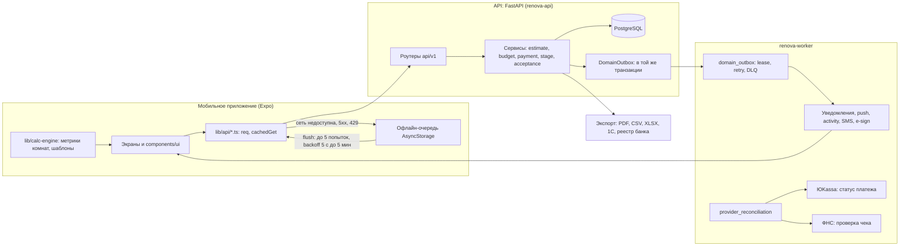
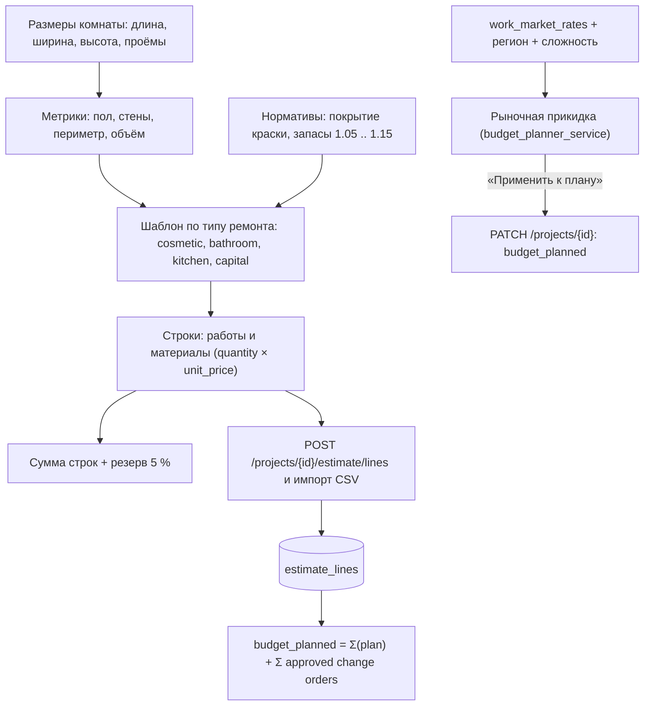
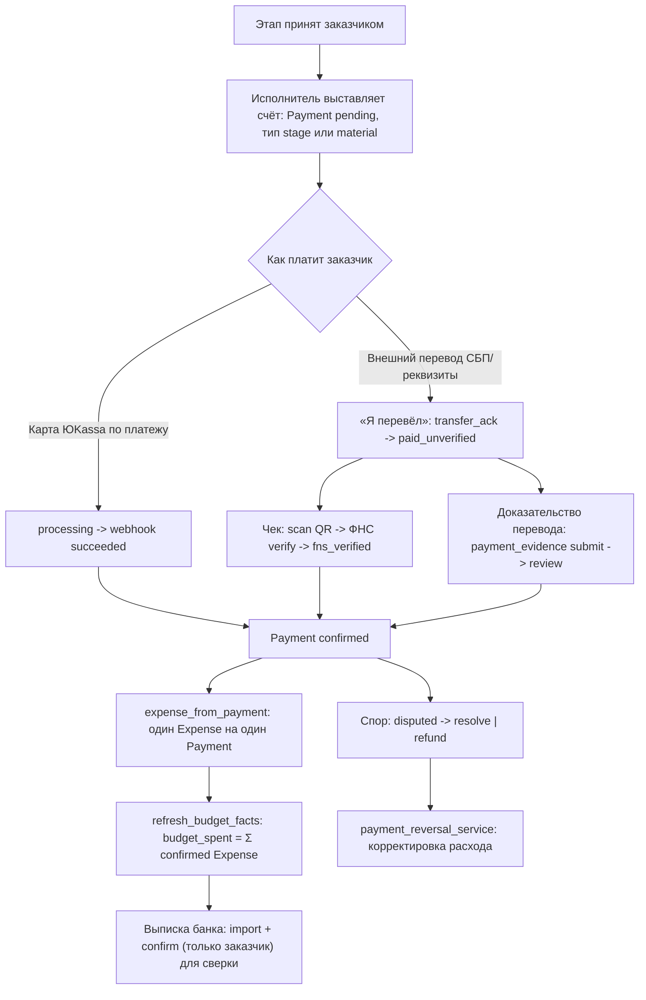
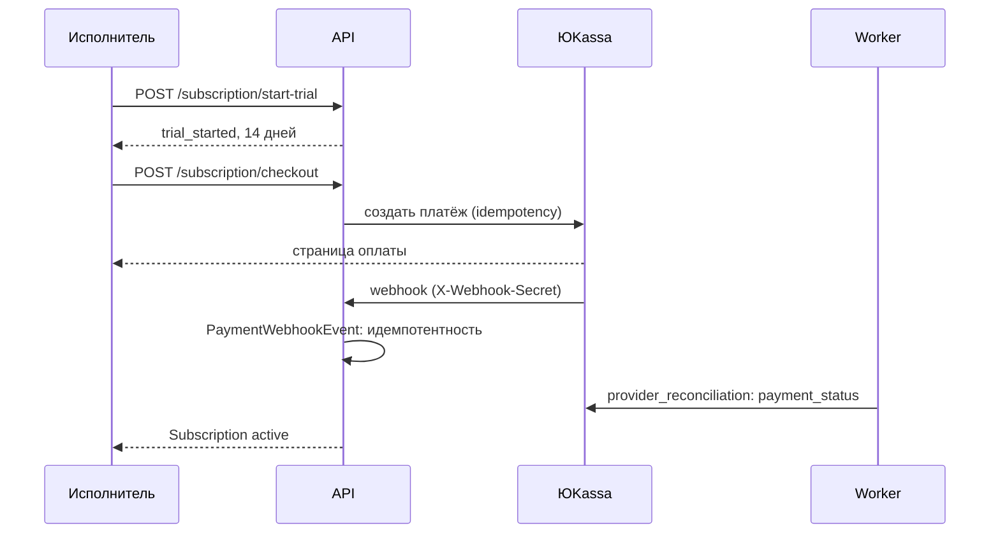
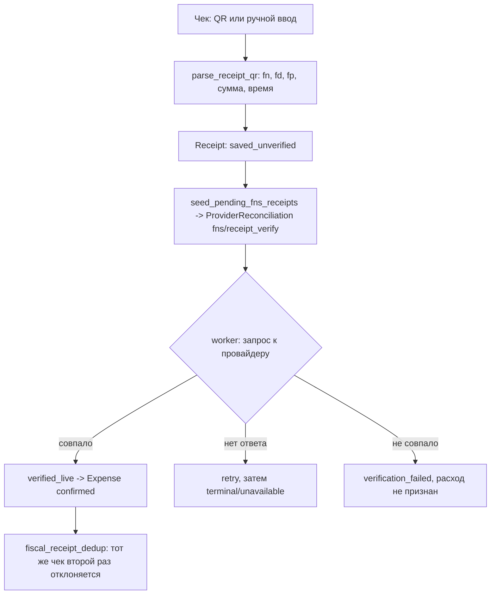

# Renova: потоки данных (смета, этапы, деньги) и встраивание в платформу «Верно»

Дата: 2026-10-15. Источник фактов: опубликованный клон (`main` + пакет документов, коммит `0af2d24`), только чтение; для «Верно» ещё `блок-схема платформы «Верно»` (разделы 4, 7, 8, 21, 31, 38). Не противоречит `AGENTS.md`, `PRODUCTION-READINESS.md`, `GOLDEN-PATHS.md`, `PRODUCT-COMPLETION-MANDATE.md` и пакету `01..07`. Всё, что не подтверждено кодом, помечено «допущение» или «предложение».

Сокращения: `B/` = `backend/app/`, `M/` = `apps/mobile/`.

## 1. Общая схема потоков



Принцип из `AGENTS.md` §4: изменение состояния, запись активности и постановка в outbox лежат в одной транзакции; внешний вызов не создаёт локального успеха, пока он не сверяем; нет «тихих» повторов и «ложных успехов» в UI.

## 2. Смета по нормам

### 2.1. Откуда берутся числа (три слоя)

| Слой | Где | Что делает | Статус |
|---|---|---|---|
| Метрики комнаты | `M/lib/calc-engine/room.ts`, зеркало `B/services/calc/estimate.py` (`calc_room_metrics`) | `пол = длина × ширина`, `периметр = 2 × (длина + ширина)`, `стены = периметр × высота − проёмы (по умолчанию 2 м²)`, `объём = пол × высота`; округление до 0.01 | проверено эталонами |
| Нормы расхода и шаблоны работ | `M/lib/calc-engine/templates.ts` (`CALC_NORMATIVES`, версия каталога `renova-mvp-ru 1.0.0`, регион `RU`, действует с `2026-07-26`, `normative-release.ts`), формулы в `formula-catalog.ts`; зеркало `B/services/calc/estimate.py` | Краска: `стены × 2 слоя / 8 м² на л × 1.05`; обои: рулоны `ceil(стены × 1.15 / 5)`; плитка запас 1.10; напольное 1.08; штукатурка 8 кг/м²; гидроизоляция 1.4 кг/м² (2 слоя); шаблоны `cosmetic`, `bathroom`, `kitchen`, `capital`; резерв 5 % | эталоны `packages/calc-engine/reference-cases.json` читают backend и mobile |
| Рыночные ставки | `B/data/work_market_rates.py` (`WORK_MARKET`: 15 видов работ, у каждого `labor_rate`, `productivity`, `material_share`), `market_regions.py` (7 регионов с `labor_index`/`material_index`, база Москва = 1.0), `B/services/budget_planner_service.py` (`estimate_market`) | «Рыночная прикидка»: `труд = количество × ставка × индекс региона × сложность (0.7..1.5)`, материалы через долю материалов, срок `количество / производительность`, при нескольких видах работ скидка 5 % на труд и 15 % на срок, резерв 5 % | **источник ставок в репозитории не указан**; даты актуальности нет |

Диаграмма расчёта:



### 2.2. Что считается и как (формулы из `CALCULATION-REGISTRY.md`)

| Показатель | Формула | Источник |
|---|---|---|
| Сумма строки | `quantity_planned × unit_price` | `budget_service._estimate_amount` |
| План бюджета | `Σ(quantity_planned × unit_price) + Σ(ChangeOrder.amount where status = approved)` | `sync_project_budget_planned`, реестр §4 |
| Факт | `budget_spent = Σ(Expense.amount where status = confirmed)` | реестр §8 |
| Отклонение | `spent − planned`, процент `round(отклонение / planned × 100, 0.1)`, при `planned = 0` равно 0 | `buildBudgetSummaryView.ts`, реестр §11 |
| Остаток | `max(0, planned − spent)` | реестр §11 |
| Перерасход по заказчику | `max(0, spent − customerBudget)` | реестр §11 |
| Прогресс по этапам | вес этапа, `weighted_progress`; на мобильном приоритет у прогресса расписания | `stage_status_service.py`, `resolveProjectProgress.ts` |
| Периоды | `periodPlanned = round(plannedTotal × overlap / projectDuration)` и распределение «наибольшим остатком» до копейки | реестр §14 |

Пример для обезличенной комнаты 4.2 × 3.1 × 2.7 м, проёмы 2 м² (эталон `spalnya-4.2x3.1x2.7` из `reference-cases.json`): пол 13.02 м², стены 37.42 м², периметр 14.6 м, краска 9.82 л, ламинат 14.06 м², обои 9 рулонов, штукатурка 299.36 кг. Проверка формулы краски: `37.42 × 2 / 8 × 1.05 = 9.82`.

### 2.3. Реестры расчётов и ограничения

- Реестр расчётов: `docs/technical-spec/CALCULATION-REGISTRY.md` (18 разделов). Правило: новая метрика требует источника, статусов, даты, валюты, округления, обработки пропусков, отмены и сверки; null не считать нулём; в `AGENTS.md` §6 запрещены эвристики вида `max(receipt, expense, estimate_fact)`.
- Две копии TS-движка и расхождение формулы краски (см. `04`, L-01): использовать `M/lib/calc-engine`; пакет `packages/calc-engine` удалить или подключить только по правилу `docs/` «no deletion without proof»: сначала доказать, что на него никто не ссылается (поиск по репозиторию находит только `package.json` workspace и lock), затем решение владельца.
- **«Динамика цен за 6 месяцев» синтетическая.** `price_trend_6m` строит ряд из сезонных коэффициентов `SEASONAL`, индекса региона и фиксированного роста 0.8 % в месяц; реальных рыночных данных там нет. Нельзя показывать как рыночную динамику ни в Renova, ни в «Верно» без явной пометки или замены источником.
- «Каталог Лемана ПРО» (`B/data/lemana_catalog.py`): жёстко зашитые средние цены и поисковые ссылки на сайт розничной сети; использование названия и цен требует проверки прав и актуальности.
- Деньги в БД хранятся `Float`, арифметика бюджета через `Decimal`; расчёт строк шаблона идёт на float (`round(n, 2)`); для API «Верно» нужно зафиксировать правило округления (раздел 7).
- Строка сметы не добавляется при утверждении допработы; допработа влияет на `budget_planned` через строку плана (перепись OBJ-14).

### 2.4. Фиксация сметы и этапы

1. Исполнитель (ведущий) отправляет смету: `POST /projects/{id}/estimate/propose-lock` сохраняет `estimate_lock_proposed_at` и снимок строк для diff.
2. Заказчик фиксирует: `POST .../lock`. Серверные проверки: `proposal_required` (если есть исполнитель), `proposal_stale` (старше 14 дней), `estimate_changed_since_proposal` (строки изменились после отправки). При успехе: `estimate_locked_at`, пересчёт бюджета, `apply_plan_from_estimate` (разнесение цены по этапам пропорционально весам, `stage_payment_plan_service.py`) и черновик договора (`ensure_contract_draft`).
3. Этап стартует явным действием исполнителя (`POST .../stages/{id}/start`), только при подписанном договоре; готовность материалов этап не стартует (`STAGE-START-AUTHORITY-CONTRACT.md`).
4. Шаблон этапов: `STANDARD_RENOVA_STAGES` из 14 этапов с весами (по замыслу 1.00: 0.03, 0.05, 0.12, 0.15, 0.10, 0.10, 0.08, 0.12, 0.05, 0.10, 0.05, 0.03, 0.05, 0.02) и профили `STAGE_PLANS` (`B/services/calc/estimate.py:120`). Для расчёта: `0.03+0.05+0.12+0.15+0.10+0.10+0.08+0.12+0.05+0.10+0.05+0.03+0.05+0.02 = 1.05`; **сумма весов в шаблоне равна 1.05, а не 1.00** (проверить арифметикой; GP3 требует «сумма весов = 100 %»). Подтверждено сложением значений. Прогресс проекта не искажается: `weighted_progress` делит на сумму весов (`stage_status_service.py:64-72`); как нормируется разнесение цены (`stage_payment_plan_service`), не проверено.

## 3. Бюджет, учётные платежи, расходы

### 3.1. Что платформа делает с деньгами

Платформа **не держит и не пересылает деньги этапов**. Платёж заказчика исполнителю это учётная запись: заказчик переводит сам (СБП, реквизиты, карта через ЮKassa по платежу), затем подтверждает в приложении; платформа фиксирует, проверяет чек и признаёт расход (`payment_service.py`, `MANUAL-PAYMENT-EVIDENCE-CONTRACT.md`, `docs/audit-map/03-money-payments-budget.md`). Любой платёжный контур с комиссией требует юридического решения до кода (`AGENTS-SNIPPET.md`, пакет `01` §6.2, §13).



Правила (из кода и реестра):
- `paid_unverified` не входит в `budget_spent`.
- Оплата этапного счёта блокируется, пока этап не принят (`payment_service.py:259`).
- Один платёж даёт один расход; дубль webhook возвращает `already_processed` (`PaymentWebhookEvent`, идемпотентность по `event_id`).
- Чек, уже привязанный к расходу, не создаёт второй расход (`fiscal_receipt_dedup_service`, реестр §6: `fns_verified -> confirmed`, иначе `pending_receipt`).
- Закупка признаётся расходом при статусах `paid`, `delivered` (реестр §5); частичная оплата и физический возврат закупки не доказаны (G06 в реестре).
- Допработа: после `approved` создаётся строка плана и (по интерфейсу) счёт, связанный колонкой `Payment.change_order_id`.

### 3.2. Бюджет: сущности

| Понятие (`AGENTS.md` §6) | Где в данных | Замечание |
|---|---|---|
| Estimate (план) | `EstimateLine.quantity_planned × unit_price`, `Project.budget_planned` | пересчёт `recalc_budget` |
| Commitment | подтверждённая допработа, согласованный подбор, закупка `approved` | отдельного хранилища обязательств нет (**допущение**: считается по статусам) |
| Purchase | `Purchase`, `PurchaseItem` | статусы раздел 4.6 пакета `04` |
| Expense | `Expense` (`confirmed`, `pending_receipt`, `disputed`, `refund`, `deleted`) | факт = только `confirmed` |
| Payment | `Payment` | движение денег между сторонами вне платформы |
| Receipt | `Receipt` | свидетельство, не расход само по себе |
| Refund | `payment_reversal_service` | обратное движение |
| Change Order | `ChangeOrder` | изменение объёма и бюджета |

Проблемные места, которые повлияют на корректную отдачу данных «Верно» (все из аудитов, не мои проверки): P0 REP-09 (любая сторона меняет статус закупки и факт бюджета), BUD-40 (исполнитель выпускает портал-токен с правами заказчика), OBJ-03 (`PATCH /projects/{id}` без проверки роли), #316 (идемпотентность при потерянном ответе), #315 (чужой контекст в очереди при смене аккаунта).

## 4. Подписка исполнителя (единственный реальный платёж платформе)

| Параметр | Значение | Источник |
|---|---|---|
| Цена | 990 ₽ за 30 дней | `subscription_service.py: PRO_PRICE` |
| Триал | 14 дней | `TRIAL_DAYS` |
| Бесплатный лимит | 1 проект на исполнителя | `config.py: contractor_free_project_limit` |
| Старт триала | `POST /subscription/start-trial` | `subscription.py:46` |
| Оплата | `POST /subscription/checkout` (маршрут заменён `subscription_integrity.py`) -> ЮKassa -> webhook `/subscription/webhook` -> сверка воркером | `router.py` |
| Возврат | очередь ручной проверки администратором | `admin_subscription_refunds.py` |
| Статусы | `free`, `active` + `expires_at` | `entities.py:438` |



Боевых ключей нет (E2); без них checkout отвечает недоступностью (`PRODUCTION-READINESS.md`). Чек 54-ФЗ на услугу подписки: вопрос к бухгалтеру (пакет `01` §6.1).

## 5. Самозанятые и ФНС

| Контур | Что делает | Где | Состояние |
|---|---|---|---|
| Статус НПД по ИНН | `POST /fns/check-npd`, `/fns/verify-me`; публичный запрос `statusnpd.nalog.ru`, ИНН 12 цифр, таймаут 65 с, ошибки `rate_limited`, `unavailable`, `protocol_error` | `services/fns/status_npd.py`, `fns.py:96,106` | реальный публичный API; на мобильном любая ошибка выглядит как «Сервис недоступен» |
| Проверка чека | разбор QR (`parse_receipt_qr`), статусы `verified_live`, `saved_unverified`, `verification_pending`, `verification_failed`, ретраи воркером | `services/fns/receipt_verify.py`, `receipts.py:224`, `provider_reconciliation_handlers.py` | зависит от провайдера и учётных данных; не подтверждено вживую |
| «Мой налог» OAuth | авто-чеки исполнителя | `moy_nalog_oauth.py`, `fns.py:179,219` | выключено до реквизитов ФНС (E1); `link` без OAuth отвечает 410 |



Юридически: пакет `01` §4.1 и §13 (НПД 4 % и 6 %, лимит 2,4 млн ₽, 289-ФЗ с 01.10.2026, критерий 60 часов для строительства). Продукт не должен обещать «автоматический налог»; чек формирует исполнитель.

## 6. Outbox, worker, офлайн-очередь, события

### 6.1. Серверная цепочка

`бизнес-транзакция -> DomainOutbox -> worker claim (lease 2 мин) -> действие -> retry с backoff (5 с, удваивая, максимум 5 мин) -> done | DLQ после 8 попыток -> оператор /admin/outbox/dead-letters`. Уникальность побочного эффекта: `uuid5(parent_outbox_id:effect_key)` и таблица `SideEffectDelivery` (`UniqueConstraint outbox_id`). Состояния: см. диаграмму 4.10 пакета `04`. Отдельный контур `ProviderReconciliation` читает истину провайдера (ЮKassa, ФНС), он не заменяет outbox для исходящих эффектов.

### 6.2. Клиентская цепочка (мобильное)

| Параметр | Значение | Источник |
|---|---|---|
| Хранилище | `AsyncStorage`, ключ `renova_offline_queue` (старые ключи мигрируют один раз) | `M/lib/offlineQueue.ts` |
| Что кладётся | мутации после сетевой/временной ошибки (`isQueueableWriteError`), например правка и добавление строки сметы | `M/lib/api/estimate.ts` |
| Повторы | `MAX_ATTEMPTS = 5`, задержка `min(5 мин, 5 с × 2^(n−1))`, учитывается `Retry-After` | `M/lib/offline/flushPolicy.ts` |
| 401 | считается просроченным токеном, обновляется и повторяется | `flushPolicy.ts` |
| Постоянные 4xx | `drop` (кроме 401, 408, 409, 425, 429) | `isPermanentClientError` |
| 409 | остаётся в очереди для ручного разбора (`/conflicts`) | `offlineQueue.ts`, `M/app/conflicts.tsx` |
| Запуск | при появлении сети (`NetInfo`, `window online`) и таймером на ближайший `nextAttemptAt` | `M/app/_layout.tsx` |
| Идемпотентность | стабильный `client_request_id` в теле, повтор после потерянного ответа попадает в ту же строку | `AddEstimateLineForm.tsx`, `B/services/client_write_idempotency.py` |
| Защита от чужой сессии | задание привязано к `userId`; закрыть #315 (смена аккаунта) | `OfflineJob.userId`, readiness #315 |

### 6.3. События и уведомления

События домена и типы уведомлений: пакет `04` §6. Основное правило: уведомление создаётся из outbox (не прямо в обработчике), ссылка переписывается под роль получателя, push проверяется воркером по квитанциям Expo.

## 7. Как Renova встраивается в платформу «Верно»

### 7.1. Что сказано в blueprint

| Место | Формулировка (кратко, пересказ) |
|---|---|
| Ядро платформы (§4) | «Ремонт (Renova)»: смета ремонта в «реальной стоимости», этапы, поэтапная оплата, подрядчики; читает планировки, нормы, подрядчиков, платежи, ФНС |
| §4 | «Сметы и этапы стройки (ИЖС)»: сравнение смет в единой структуре, поэтапная оплата по актам и фото; читает подрядчиков, технадзор, участок, ипотеку на строительство |
| §4 | «Приёмка и паспорт квартиры»: дефекты, претензии, гарантийные случаи, история объекта |
| §21 | Для клиента до покупки: «сколько будет стоить ремонт этой квартиры» по площади и планировке; после покупки: смета, этапы, оплата, контроль; дефекты приёмки переходят в задачи ремонта; история ремонта в паспорте квартиры. Блок завершается советом начать с простого: смета ремонта в карточке квартиры и ссылка на подрядчика. Приоритет 1 в прототипе |
| §38 финмодель | «Ремонт через Renova (комиссия)» как строка дохода: доля клиентов, средний чек, комиссия |
| §21 риски | ответственность за качество ремонта, договоры подряда, точность смет, интеграция двух продуктов |

Важно: в blueprint сам текст говорит, что интеграция описана по общему описанию репозитория и состояние Renova надо сверять с командой (§34). Ниже это сделано по коду.

### 7.2. Что в Renova уже есть для этого, а чего нет

| Потребность «Верно» | Есть в Renova | Нет или ограничено |
|---|---|---|
| Оценка ремонта по площади и планировке без проекта | `calc-engine` (метрики + шаблоны), `estimate_market` (рынок) | Метрики и шаблоны живут внутри проекта; рыночная прикидка (`/market/estimate`) уже без аккаунта, но по ставкам без источника. Источник ставок не указан, регион = 7 индексов, динамика синтетическая |
| «Реальная стоимость» с диапазоном от-до | Резерв 5 %, сложность 0.7..1.5 | Диапазон от-до и дата актуальности ставок не заданы |
| Смета в карточке квартиры | Шаблоны `cosmetic`, `bathroom`, `kitchen`, `capital`, эталонные тесты | Планировка квартиры -> комнаты: импорта планировки нет (`floor_plans` хранит загруженный план и точки замечаний) |
| Переход «квартира -> проект ремонта» | `project_creation.py`, `marketplace_conversion_service.py` (лид в проект, идемпотентная конверсия) | Контракт передачи объекта и согласие пользователя |
| Дефекты приёмки -> задачи ремонта | `ProjectIssue`, замечания на плане, work order из сообщения | Общая сущность «дефект» между продуктами |
| Паспорт квартиры: история ремонта | Документы (версии, подписи), акты, гарантия, `full-dossier.pdf`, `activity-dossier.pdf` | Экспорт по согласию в машинном виде |
| ИЖС: сравнение смет, поэтапная оплата | Этапы, акты, приёмка, технадзор, фото | Шаблонов работ ИЖС нет; сравнение чужих смет нет; ипотека на стройку вне Renova |
| Подрядчики, рейтинг | Профиль исполнителя, портфолио, заявки, `contractor_reputation_service.py` | Публичный рейтинг по правилам §19-20 blueprint не реализован |

### 7.3. Предложение API-контракта (черновик, не код)

Принципы: «Верно» вызывает Renova по API, единый сервис расчёта (не копия в «Верно»); версионирование норм; без ПДн в расчётном входе; всё идемпотентно; согласие пользователя фиксируется отдельным объектом; любые деньги остаются учётными.

Версия контракта: `v1`. Базовый префикс: `/api/v1/partner/verno/...` (**предложение**; существующих таких маршрутов нет).

#### A. Оценка ремонта (направление: Верно -> Renova, только чтение, без аккаунта)

`POST /partner/verno/v1/repair-estimates`

Вход (пример, вымышленные значения):

```json
{
  "request_id": "client-generated-uuid",
  "as_of": "2026-10-15",
  "region_code": "moscow",
  "currency": "RUB",
  "property": { "kind": "apartment", "total_area_sqm": 54.0, "ceiling_height_m": 2.7 },
  "rooms": [
    { "key": "r1", "type": "living", "length_m": 5.0, "width_m": 4.0, "height_m": 2.5, "openings_sqm": 3.0 }
  ],
  "scope": "cosmetic",
  "complexity": 1.0,
  "ruleset": "renova-mvp-ru@1.0.0"
}
```

Выход:

```json
{
  "request_id": "...",
  "ruleset": { "catalog_id": "renova-mvp-ru", "version": "1.0.0", "effective_from": "2026-07-26" },
  "rates_source": { "id": "...", "as_of": "...", "kind": "static_table | market_survey" },
  "currency": "RUB",
  "rounding": "half_up_2",
  "total": { "low": 0, "base": 0, "high": 0, "reserve_percent": 5 },
  "breakdown": [{ "room_key": "r1", "line": "work|material", "name": "...", "unit": "m2", "qty": 0, "unit_price": 0, "amount": 0 }],
  "disclaimer_code": "rough_estimate_not_contract",
  "confidence": "low | medium"
}
```

Правила: диапазон `low..high` обязателен, пока ставки не имеют документированного источника; поле `rates_source.kind = static_table` обязывает «Верно» показывать пометку «ориентировочно»; `disclaimer_code` не удаляется интерфейсом «Верно». Запрос не создаёт проектов и не хранит ПДн; идемпотентность по `request_id`.

#### B. Создание проекта ремонта из квартиры (Верно -> Renova, после согласия)

`POST /partner/verno/v1/repair-projects` с заголовком `Idempotency-Key`.

Вход: `{ "consent_id": "...", "verno_unit_id": "...", "customer": { "verno_user_id": "...", "phone_verified": true }, "property": { ... }, "rooms": [ ... ], "defects": [ { "ref": "...", "room_key": "...", "description": "...", "photo_ids": ["..."] } ] }`.

Выход: `{ "project_id": "...", "deeplink": "renova://project/...", "status": "created" }`. Правила: пользователь Renova определяется по подтверждённому телефону (связь аккаунтов по согласию, не по переданным данным); проект создаётся через `project_creation.py` (не через legacy-путь), конверсия идемпотентна как в GP2; фото дефектов передаются как ссылки на объекты хранилища с коротким сроком жизни, а не как base64.

#### C. Статус проекта и этапов (Renova -> Верно, события)

`POST` на веб-хук «Верно» из outbox Renova (подписка по `consent_id`), события в формате `объект.действие`:

| Событие | Когда | Данные (без денег и ПДн по умолчанию) |
|---|---|---|
| `repair.project_created` | создан проект | `project_id`, `verno_unit_id` |
| `repair.estimate_locked` | смета зафиксирована | `project_id`, `ruleset`, `total` (по согласию), `locked_at` |
| `repair.stage_accepted` | принят этап | `stage_ref`, `weight`, `accepted_at` |
| `repair.defect_closed` | закрыт дефект | `ref` |
| `repair.closeout` | завершение объекта | `project_id`, ссылка на досье по согласию |

Правила: доставка через существующий `DomainOutbox` (новый `event_type` + обработчик в `outbox_service._handle`), детерминированные идентификаторы, подпись HMAC и повтор с backoff, DLQ виден оператору. Обработчик `unknown_outbox_event_type` по умолчанию бросает ошибку, поэтому новый тип нужно добавлять в тот же PR с тестом.

#### D. Паспорт квартиры (Renova -> Верно, чтение по согласию)

`GET /partner/verno/v1/repair-projects/{project_id}/passport` -> перечень выполненных работ (категории, даты, принятые этапы), материалы без цен поставщиков, гарантии, ссылки на документы. Права: токен партнёра + `consent_id` с областью `passport.read`; отзыв согласия закрывает доступ. Хранение и удаление по 152-ФЗ (пакет `01` §13).

#### E. Идентичность и согласие

- Единый вход «Верно» и Renova предполагает общую идентичность; сейчас у Renova свой OTP-вход по SMS (`otp_auth.py`). Минимально: связывание по подтверждённому телефону и явное согласие.
- Объект `consent`: `consent_id`, `subject`, `scopes[]` (`estimate.write`, `project.create`, `events.read`, `passport.read`), `granted_at`, `revoked_at`, версия текста. Хранить в Renova и в «Верно».

### 7.4. Что можно делать, не нарушая инварианты Renova

| Что | Почему допустимо | Условие |
|---|---|---|
| Сервис «смета-оценка» только чтение (контракт A) | Не создаёт денег и проектов; опирается на `calc-engine` с эталонами | Единая копия движка (устранить L-01); диапазон и дата ставок; запись в `CALCULATION-REGISTRY.md` нового расчёта (требование `PRODUCT-COMPLETION-MANDATE`/реестра) |
| Создание проекта ремонта по согласию (контракт B) | Использует канонические `project_creation` и конверсию GP2 | Идемпотентность, ACL, согласие, тесты на межпроектный доступ |
| События и паспорт (контракты C, D) | Через `DomainOutbox`, без новых фоновых механизмов | Новый `event_type` с тестом, `unknown_outbox_event_type` не должен срабатывать |
| Ссылка на проверенных исполнителей («Верно» -> лиды) | Уже есть job-leads и конверсия | Рейтинг и правила видимости из blueprint §19-20 не использовать до реализации |
| Дефекты приёмки -> замечания Renova | `ProjectIssue` существует | Общая схема и права: кто закрывает |

### 7.5. Чего делать нельзя (или пока нельзя)

| Что | Почему |
|---|---|
| Платёжный контур с комиссией, поэтапная оплата «через платформу», эскроу, рассрочка | Платформа не держит деньги; любой контур требует юридического решения (289-ФЗ, платёжный агент, ЦБ) до кода (`AGENTS-SNIPPET.md`, пакет `01` §6.2, §13). Строка «Ремонт через Renova (комиссия)» в финмодели blueprint (§38) не должна попасть в базовый сценарий |
| Копировать расчёт в «Верно» | Два источника правды расходятся (пакет `01`, риски); использовать только API |
| Показывать «динамику цен» из `price_trend_6m` как рыночную | Это синтетический ряд (раздел 2.3) |
| Выдавать оценку за смету или обещание цены | Ответственность и ожидания клиента; нужен `disclaimer_code` и диапазон |
| Передавать данные квартиры и фото без согласия, на неподтверждённые адреса | 152-ФЗ; `AGENTS.md` §7 (границы доступа, IDOR) |
| Зависеть от Renova до её запуска | Решение о запуске `BLOCKED_FOR_BROAD_PRODUCTION` (`PRODUCTION-READINESS.md`) |
| Использовать рейтинг подрядчиков, технадзор и «знак качества» как рекомендацию платформы | Ответственность платформы; не реализовано |
| Называть подписи квалифицированными | Контур/Госключ не боевые |
| Применять `Alert.alert`-подтверждения на web для критичных действий «Верно» | Перепись SCR-001: на web диалог не показывается |

### 7.6. ИЖС: что реально переносится

Переносимо: этапы, акты приёмки, фото этапов, технадзор (`technical_supervision*`), документы, учётные платежи по этапам, замечания на плане. Нужно создать: шаблоны работ ИЖС (фундамент, коробка, кровля, инженерные системы, отделка) в `workflow_templates` и в `calc-engine` с эталонами; нормы расхода для бетона, кладки, кровли; поддержку нескольких этажей и объёмных метрик (сейчас только комнаты и высота); сравнение смет разных подрядчиков в единой структуре (в Renova нет такой сущности: придётся ввести «версию сметы» и связь с `JobLeadQuote`); ипотека на строительство остаётся за «Верно» и банками. Оценка трудоёмкости не приводится (в репозитории нет оснований).

### 7.7. Последовательность работ (предложение, соблюдая `PRODUCT-COMPLETION-MANDATE`)

1. Устранить дубль calc-engine и расхождение краски (малый PR, тест равенства TS и Python на `reference-cases.json` для всех шаблонов, не только метрик).
2. Источник и дата ставок: заменить «Москва» без источника на документированный набор (или явно назвать как внутреннюю оценку) и добавить диапазон.
3. Контракт A как read-only сервис, с записью в реестр расчётов.
4. Согласие и идентичность (контракты B, E).
5. События и паспорт (C, D) после появления внешнего staging (E6) и закрытия P0 (#316, #315, REP-09, BUD-40, OBJ-03).
6. ИЖС как отдельный набор шаблонов после пилота квартир.

Критерий проверки каждого шага: тесты равенства расчёта (±0.01 ₽, GP1), негативные тесты доступа (404 вместо 403 для чужого проекта, GP1 N2), идемпотентный повтор запроса (GP2 п. 4), отсутствие нового фонового механизма вне outbox.

## Что осталось неподтверждённым

- Источник, дата и методика ставок `WORK_MARKET` и индексов регионов; фактическая точность смет.
- Сумма весов шаблона этапов 1.05: прогресс нормируется (проверено), нормировка разнесения цены по этапам не проверена.
- Полная таблица переходов платежа и поведение частичной оплаты и возвратов закупок (G06).
- Состав и поведение ЮKassa и ФНС на живых провайдерах (ничего не запускалось).
- Правовая квалификация Renova и «Верно» по 289-ФЗ и платёжному праву; юридическая схема комиссии.
- Прототип «Верно»: blueprint сам указывает, что интеграцию надо сверить с реальным состоянием; кода «Верно» нет.
- Все предложенные маршруты `/partner/verno/...` и объекты `consent` не существуют в коде.

## Расхождения с пакетом 01-03

1. Пакет `01` §3 и «Верно»: «`packages/calc-engine`, шаблоны `cosmetic` и `bathroom`, остальные типы объявлены без шаблонов». Живой движок `apps/mobile/lib/calc-engine` содержит четыре шаблона; `packages/calc-engine` не используется. См. `04` L-01.
2. Пакет `01` §3: «округление `Decimal`, ROUND_HALF_UP» для сметы. Для денег бюджета верно; строки шаблонов считаются на float.
3. Пакет `01` пишет, что оценке без проекта и аккаунта «нужен сервис». Эндпоинты `POST /api/v1/market/estimate` и `GET /api/v1/market/regions` уже существуют и **не требуют авторизации** (в обработчиках нет `Depends(get_current_user)`; ограничивает только `RateLimitMiddleware`) (`B/api/v1/budget_planner.py:26-47`). Это ускоряет контракт A, но означает, что неаудированная «рыночная прикидка» сейчас доступна анонимно; решить, оставлять ли так.
4. Пакет `01` называет динамику цен как возможность «правды»; код её строит синтетически (раздел 2.3).
